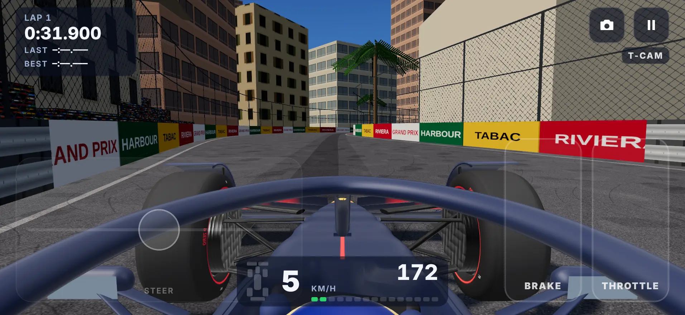
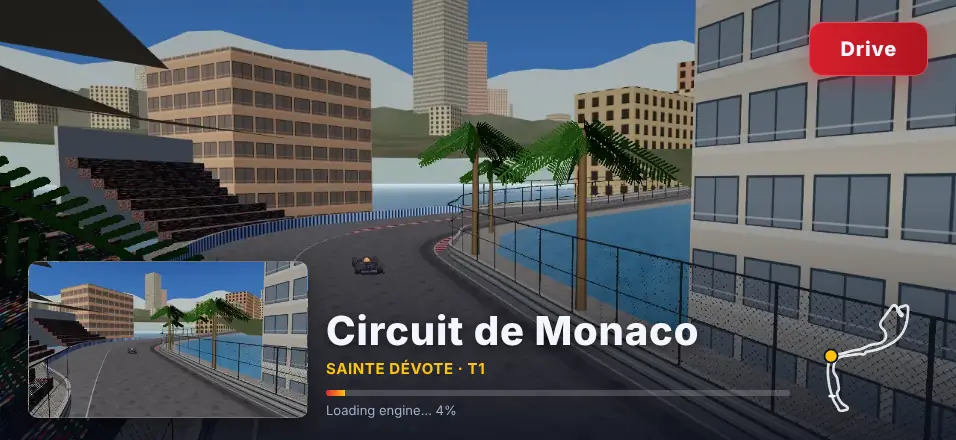
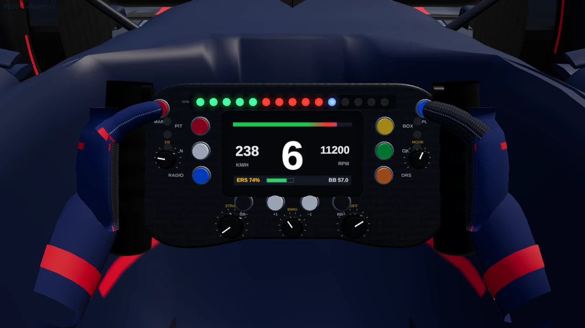

# F1-27 · Monaco Time Trial — RB20

A mobile-first 3D Formula 1 time trial around the **Circuit de Monaco** in Max Verstappen's
**2024 Oracle Red Bull Racing RB20** (Monaco high-downforce specification). Landscape, two
thumbs, opens straight from a link. Static site — no build step; three.js r170 (WebGL 2) is
vendored.

**Play:** https://loyoso34.github.io/Monaco-F1-Mobile/



| Loading | Steering wheel | Mirror (live reflection) |
|---|---|---|
|  |  |  |

## Driving

* **Left thumb:** steering zone (bottom-left) — put your thumb down anywhere in it and slide
  left/right; let go and the wheel recentres smoothly. The steering wheel, the driver's hands and
  the front wheels all turn the way you steer (4.4:1 steering ratio, 23° road-wheel lock).
* **Right thumb:** **Brake** and **Throttle** pedals. Press higher on a pad for more: the brake
  pad maps the thumb height to pedal pressure, so you can trail off the brake as the downforce
  drops. Slide from throttle to brake and the throttle releases instantly.
* **No ABS** — F1 cars have none. Stamp on the brake at low speed and the fronts lock: the brake
  pad glows amber while a front tyre is locked. Release a little and the tyre grips again.
  Settings → Driving assists: *Standard* adds traction control on the throttle (a game aid; the
  real car has none since 2008), *Off* is the real thing. Braking is never assisted in either.
* **Automatic 8-speed gearbox** (gear on the HUD and the steering-wheel display). Hold the brake
  at a standstill to engage reverse; touch the throttle to go forward again.
* Top-right: **camera** (T-cam → Cockpit → Chase) and **pause** (Resume, Quick Restart, Reset Car,
  Settings, Return to Menu).
* Keyboard (desktop): arrows / WASD, C camera, P pause, R reset car.

**Rules:** timing starts on your first forward crossing of the line; a lap counts after every
checkpoint in order and a forward crossing. Cutting the Nouvelle Chicane or either Swimming
Pool chicane shows "Lap invalid — corner cut." — keep going and a fresh lap starts at the line.
Reset Car keeps damage and invalidates the lap; Quick Restart repairs the car and clears timing.
Your best valid lap is saved on the device.

## What's inside

| Area | Highlights |
|---|---|
| **Car** (`js/carspec.js`, `js/carmodel.js`, `js/livery.js`, `js/decals.js`) | Procedural RB20 built from a measured dimension sheet ([docs/CAR_DIMENSIONS.md](docs/CAR_DIMENSIONS.md)): lofted survival cell with real cockpit opening, nose cross-sections, 4-element front wing with endplates, pull-rod/push-rod suspension on real pick-ups, steering about the kingpin, carbon aero halo, RB20 sidepods with the deep undercut, inlet duct and overbite lip, floor fences, front brake-duct scoops and rear duct winglets, diffuser, Monaco rear wing + beam wing, soft tyres with rim lips. Sponsor wordmarks are **conformal decals** projected onto the body triangles with their own high-resolution textures (sharp from the onboard cameras). |
| **Cockpit** (`js/cockpit.js`) | RB20-style steering wheel: carbon-weave body with clearcoat, suede grips, a live **digital display** (gear, speed, rpm bar, ERS, brake bias, lock warning), **15 shift LEDs** (green → red → blue, flashing at the limiter) and 6 side LEDs, labelled buttons, knurled rotaries, thumb wheels, shift and clutch paddles. **Gloved hands** (knit glove texture, stitched seams, wrist cuff and strap) grip the wheel and turn with it; the **arms follow by two-bone IK** from the shoulders, so nothing detaches or stretches. |
| **Mirrors** (`js/mirrors.js`) | Real-time rear-view mirrors: each 200 × 50 mm glass is a planar reflector rendered every other frame into its own WebGL render target from the viewer's eye mirrored in the glass plane, through an off-axis frustum that passes exactly through the glass (perspective-correct for T-cam, cockpit and chase cameras). Mounted on thin blade stays above the sidepod inlets. |
| **Camera** (`js/cameras.js`) | Broadcast **T-cam on the roll hoop** (1.885 m behind the front axle, 0.985 m high) is the default; driver-eye cockpit and chase cams. Rigidly anchored to the chassis; wide-screen FOV keeps 16:9 proportions. |
| **Audio** (`js/engine-worklet.js`, `js/audio.js`) | Synthesised V6 turbo-hybrid in an AudioWorklet driven by rpm, load and gear (shift cuts, blips, overrun, MGU-K, turbo), tyre scrub, wind, kerbs, scrapes, impacts and tunnel reverb. See [docs/TRACK_AND_AUDIO.md](docs/TRACK_AND_AUDIO.md). |
| **Circuit** (`js/track-core.js`, `js/corridor.js`, `js/trackmesh.js`, `js/scenery.js`, `js/textures.js`) | Geo-referenced centre line scaled to 3,337 m, 43 m of elevation, kerbs, armco and catch fences, braking boards, pit lane, harbour with yachts, grandstands, Casino, Fairmont, the Rock and the Palace. **PBR street asphalt** (aggregate, binder, normal and roughness maps; 40 m macro variation so the tile never repeats), rubber laid along the racing line, braking and lock-up marks into every braking zone (generated from the speed profile), traction marks out of the corners, saw-cut repair patches, crack-seal lines, manhole covers and gutter grates; painted kerbs and lines. A track exclusion corridor keeps every building, the terrain and all props off the circuit. The tunnel has a continuous slab ceiling, beams, LED luminaire rows and smooth light / exposure transitions. |
| **Physics** (`js/physics.js`, `js/damage.js`) | 240 Hz planar dynamics; combined-slip tyre model with **wheel rotational dynamics** (each wheel's spin is integrated, so lock-ups and wheelspin emerge from torque balance, not thresholds); hydraulic brake pressure build-up, 57–59.5 % forward brake bias with rear brake-by-wire compensating MGU-K harvesting; load transfer from filtered accelerations; speed-dependent downforce; limited-slip differential; fuel-flow-limited power + ERS; barrier contact at the real extremities, frangible wings/nose/wheels, survival cell. |
| **Game** (`js/main.js`, `js/controls.js`, `js/timing.js`, `js/hud.js`, `js/perf.js`) | Cinematic loading screen (F1-27 · Oracle Red Bull Racing · Max Verstappen · Monaco Grand Prix · Time Trial) with real progress, fade into the menu, HUD, settings, pause on focus loss, portrait prompt, PWA. Adaptive quality: render resolution first, then shadows; mirror resolution follows the quality tier. |

## Publishing

The game is served by **GitHub Pages** from the `main` branch, folder `/ (root)`, at
https://loyoso34.github.io/Monaco-F1-Mobile/ — every push to `main` is live about a minute
later. On iPhone, Share → *Add to Home Screen* gives a full-screen landscape app.

Every path is relative, so the site works from the project sub-path; `.nojekyll` makes Pages
serve the files as they are. The service worker fetches code network-first, so a normal reload
picks up new versions.

## Development

```bash
node tools/serve.mjs 8080             # then open http://localhost:8080
node tools/gameplay-test.mjs out      # emulated-phone acceptance tests (43 checks)
node tools/inspect-circuit.mjs        # nothing on the circuit: terrain + every scenery triangle, all tiers
node tools/straight-line-test.mjs     # zero-steering straight-line and barrier-brush tests (Node)
node tools/tunnel-test.mjs out        # tunnel light / exposure transitions + frames
node tools/views.mjs out all          # inspection screenshots: problem spots, road surface, mirrors, halo
node tools/sim-lap.mjs 3              # headless physics laps with the test driver
node tools/track-report.mjs           # circuit geometry report
node tools/shots.mjs out side,front,top,rear34,tcam,cockpit,halo34,wheelfront   # model validation renders
node tools/perf-probe.mjs             # draw calls, triangles, CPU per frame, memory
node tools/capture.mjs                # promotional stills rendered from the game (assets/)
```

Debug URL parameters: `?start=drive`, `?cam=chase|cockpit`, `?q=low|medium|high`, `?fps=1`,
`?autopilot=1`, `?noaudio=1`, `?norender=1`, `?s=<lap metre>` (start position), `?cine=<n>`.

See [docs/TESTING.md](docs/TESTING.md) for the test matrix, performance numbers and what still
needs a physical-phone check.

## Credits and licences

* Circuit trace: [bacinger/f1-circuits](https://github.com/bacinger/f1-circuits) (MIT).
* [three.js](https://threejs.org) r170 (MIT), vendored in `vendor/three/`.
* All textures, models and sounds are generated procedurally by this project.
* This is an unofficial, non-commercial fan project. Team, driver, sponsor and supplier names
  appear as plain-text approximations of the 2024 livery for realism; they belong to their
  respective owners and no official artwork or logos are included.
