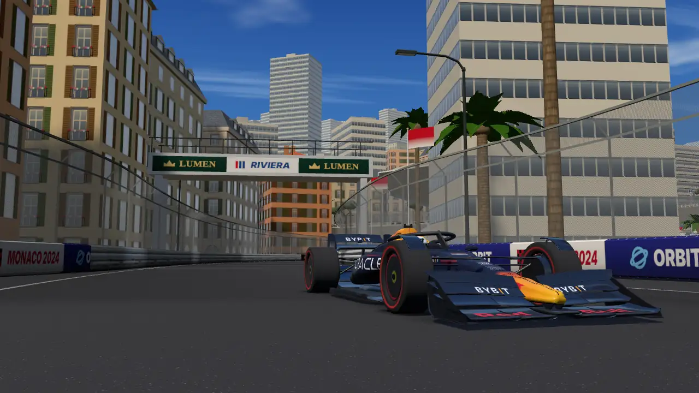
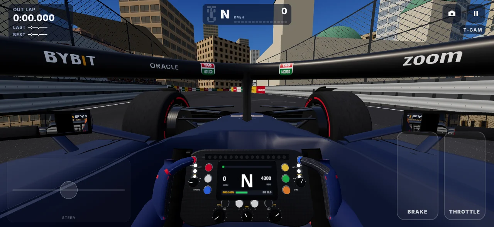
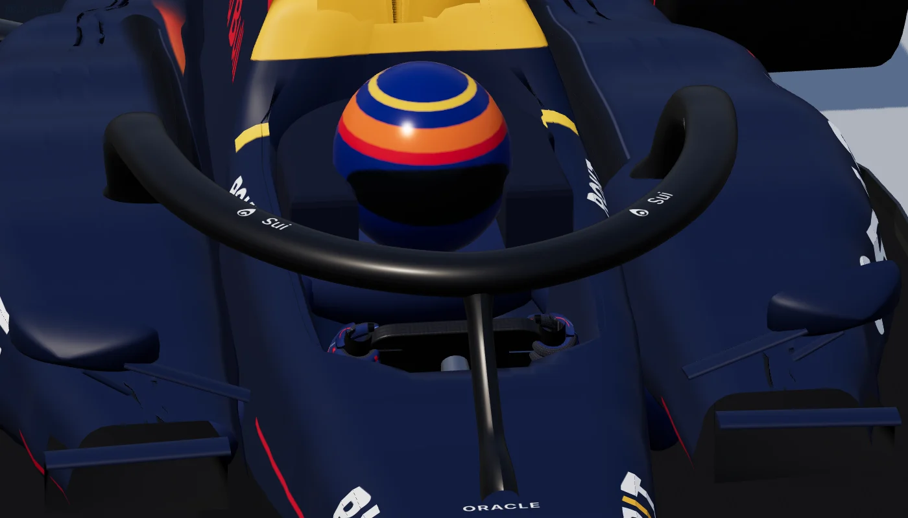
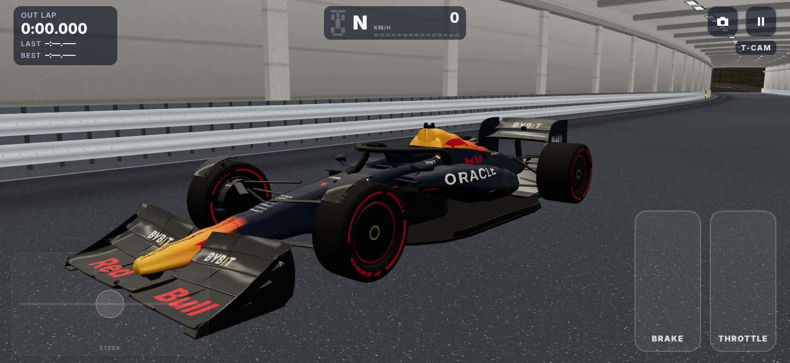

# F1-27 · Monaco Time Trial — RB20

A mobile-first 3D Formula 1 time trial around the **Circuit de Monaco** in Max Verstappen's
**2024 Oracle Red Bull Racing RB20** (Monaco high-downforce specification). Landscape, two
thumbs, opens straight from a link. Static site — no build step; three.js r170 (WebGL 2) is
vendored.

**Play:** https://loyoso34.github.io/Monaco-F1-Mobile/



**Before / after the 2026 environment upgrade**: [around the circuit](docs/img/env-elevated.webp) ·
[T-cam](docs/img/env-tcam.webp) · [driver's eye](docs/img/env-onboard.webp) ·
[details](docs/img/env-details.webp)

**Before / after the 2026 visual overhaul** (driver's eye at racing speed, phone landscape size):
[Sainte Dévote to the hairpin](docs/img/overhaul-onboard-1.webp) ·
[tunnel to Tabac](docs/img/overhaul-onboard-2.webp) ·
[Swimming Pool to Anthony Noghes](docs/img/overhaul-onboard-3.webp) ·
[T-cam](docs/img/overhaul-tcam.webp) · [menus and HUD](docs/img/overhaul-ui.webp)

| Cockpit | Halo markings | In the tunnel |
|---|---|---|
|  |  |  |

## Driving

* **Left thumb:** steering zone (bottom-left) — put your thumb down anywhere in it and slide
  left/right; let go and the wheel recentres smoothly. The steering wheel, the driver's hands and
  the front wheels all turn the way you steer (4.4:1 steering ratio, 23° road-wheel lock).
* **Right thumb:** **Brake** and **Throttle** pedals. Press higher on a pad for more: the brake
  pad maps the thumb height to pedal pressure, so you can trail off the brake as the downforce
  drops. Slide from throttle to brake and the throttle releases instantly.
* **No ABS** — F1 cars have none. Stamp on the brake at low speed and the fronts lock: the brake
  pad glows amber while a front tyre is locked. Release a little and the tyre grips again.
  Settings → Driving assists: *Standard* adds traction control on the throttle and a brake-lock
  aid that eases the pressure like a driver's foot when the fronts pass their peak slip (game
  aids; the real car has neither), *Off* is the raw car.
* **Throttle pad:** the top third is full throttle; lower on the pad feeds the power in
  progressively (25 % at the bottom edge) for slow-corner exits.
* **Automatic 8-speed gearbox** (gear on the HUD and the steering-wheel display). Hold the brake
  at a standstill to engage reverse; touch the throttle to go forward again.
* Top-right: **camera** (Cockpit → T-cam → Chase; the driver's-eye cockpit is the default) and
  **pause** (Resume, Quick Restart, Reset Car, Settings, Return to Menu).
* The controls sit low in the corners, clear of the apex, both mirrors and the wheel display; the
  steering zone lights up while your thumb is on it.
* **Language:** Türkçe / English, from the flags at the top-right of the main menu (or Settings →
  Language). The switch is instant, everywhere (menus, HUD, controls, messages, loading screen),
  and remembered on the device; the first visit follows the phone's language.
* Every button acts on the first tap, with a pressed state as soon as it is touched; the steering
  zone and both pedals work together with three thumbs/fingers down.
* Keyboard (desktop): arrows / WASD, C camera, P pause, R reset car.

**Rules:** timing starts on your first forward crossing of the line; a lap counts after every
checkpoint in order and a forward crossing. Cutting the Nouvelle Chicane or either Swimming
Pool chicane shows "Lap invalid — corner cut." — keep going and a fresh lap starts at the line.
Reset Car keeps damage and invalidates the lap; Quick Restart repairs the car and clears timing.
Your best valid lap is saved on the device.

## What's inside

| Area | Highlights |
|---|---|
| **Car** (`js/carspec.js`, `js/carmodel.js`, `js/halo.js`, `js/helmet.js`, `js/livery.js`, `js/decals.js`) | Procedural RB20 built from a measured dimension sheet and matched against a 2024 side photograph with a camera-matched render (`tools/refmatch.mjs`, [comparison](docs/img/ba-reference-side.webp)). **Halo**: slim tapered D-section fairing (~60 × 47 mm on the rails, fuller at the front corners, thickening down the legs, a short fillet into the bodywork), hoop front top at 0.865 m falling ~9 cm to legs that run into the **raised cockpit shoulders** (~0.76 m) just ahead of the airbox; broad swept centre pillar following the photo's leading edge; 2024 markings as a conformal skin. **Shoulders** continue past the airbox; ROKT sits on the wall under them. **Floor body**: sculpted clear-coated carbon between the floor and the sidepod undercut, carrying the RAUCH badge. **Helmet**: shaped shell with chin bar, tinted visor in its rubber gasket, pivots, vents, rear spoiler, livery after the reference; seated with its top level with the halo arm (eye 0.728 m) in a tall head surround with a dark, shadowed gap. Sponsor graphics are vector artwork projected onto the body: ORACLE drawn from geometric glyphs (cap 0.15 m from 1.27 m behind the axle), BYBIT on the flat chassis side with the red line through it, RAUCH as the bordered oval with its fruit mark. |
| **Cockpit** (`js/cockpit.js`) | Driver's eye at the height the 2024 photos give (helmet top level with the halo arm) with a helmet-camera field of view: halo crossbar and markings at the top, pillar ahead of the nose, both front tyres, both mirrors at the frame edges. RB20-style wheel: carbon body, suede grips, live **display** (gear, speed, rpm bar, ERS, brake bias / LOCK), **15 shift LEDs** with glow and 6 side LEDs, labelled buttons, rotaries, thumb wheels, paddles. **Gloved hands** built on the grip surface itself (fingers in moulded grooves) turn with the wheel; **arms by two-bone IK**. The wheel turns the same way as the front tyres (4.4 : 1). |
| **Mirrors** (`js/mirrors.js`) | Real-time rear-view mirrors at the 2024 position (200 × 50 mm glass, 1.13 m behind the front axle, on blade stays above the sidepod inlets), aimed from the driver's eye and slightly convex: the track behind with a sliver of the car's flank. Each glass is a planar reflector rendered into its own WebGL render target through an off-axis frustum that passes exactly through the glass, on alternate frames, skipped when off-screen. |
| **Camera** (`js/cameras.js`) | **Driver's eye** is the default (eye 0.728 m, helmet top level with the halo arm; on a 2.17 : 1 phone ~75° vertical / ~118° horizontal so both mirrors stay in frame, pitched so the horizon sits at ~43 % with the wheel display below); broadcast **T-cam on the roll hoop** (1.885 m behind the front axle, 0.985 m high) and chase cam. Rigidly anchored to the chassis. |
| **Light & colour** (`js/lighting.js`, `js/envmap.js`, `js/carenv.js`) | One shared colour pipeline for the game and the model viewer: sRGB textures, linear lighting, a hue-preserving highlight roll-off without a toe (PBR-Neutral's compression; its toe and ACES both crushed the dark navy to saturated blue-black and pushed the orange airbox towards yellow), sRGB output. Sun as the key light, the HDR environment as the PBR materials' sky (hemisphere fill reduced on them), sun-lit street bounce in the environment. **Live reflections**: a small cube map of the surroundings round the car (one face per frame, PMREM-filtered) is the car's environment, so facades, the harbour and the tunnel lamps slide across its curved panels. Satin clear-coated navy (calibrated against the white lettering of the reference photo), glossy and floor-body carbon, satin-black halo, rubber, tinted visor, mirror glass. Car self-shadowing in a tight shadow frustum. |
| **Audio** (`js/engine-worklet.js`, `js/audio.js`) | Synthesised V6 turbo-hybrid in an AudioWorklet driven by rpm, load and gear (shift cuts, blips, overrun, MGU-K, turbo), tyre scrub, wind, kerbs, scrapes, impacts and tunnel reverb. See [docs/TRACK_AND_AUDIO.md](docs/TRACK_AND_AUDIO.md). |
| **Circuit & city** (`js/track-core.js`, `js/corridor.js`, `js/trackmesh.js`, `js/scenery.js`, `js/city.js`, `js/shade.js`, `js/textures.js`) | Geo-referenced centre line scaled to 3,337 m, 43 m of elevation, kerbs, PBR street asphalt with rubber, braking and traction marks. **Trackside at true scale**: triple galvanised W-beam Armco (three 0.31 m rails as relief geometry, bolts, grime, tyre rubbing), banners stretched over the rails in three generic sponsor sets, Tecpro blocks; **catch fences** of 50 mm chain link (mipmapped coverage, so the mesh averages to a still veil instead of shimmering) on painted posts every 4 m, 2.75 m upright with a top panel leaning in over the track; contact shadows where the barriers meet the road and where walls meet the pavement. Empty **grandstands** (concrete terraces, rows of red seats, aisles, railings). **Architectural city** (`js/city.js`): every building built floor by floor from a facade atlas of district styles — belle-époque Monte-Carlo, pastel La Condamine with shutters, modern balconied blocks, the old town, seafront hotels — on every face; buildings along the circuit get shopfronts and awnings, balconies with shaded undersides and parapets, string courses, cornices, roof parapets, plant rooms and terracotta hip roofs. Window and door openings are **set back into the walls** by a parallax facade shader (the glass shifts and the reveals show as the car passes). Moored **motor yachts** with sheer lines, boot stripes, tinted glass decks and flybridges line the harbour. Monaco **rises in layers** up the hillside (Moneghetti, Beausoleil) in contour-aligned terraces; the Casino (twin towers, dome), Hôtel de Paris, the Sainte-Dévote chapel and the Fairmont; stone retaining walls from Mirabeau round the hairpin to Portier; the seafront opens to the harbour at the tunnel exit. **Sun and shade** between the buildings baked into the road, kerbs, barriers and fences (`js/shade.js`); the car's sunlight fades in the same shade. A track exclusion corridor keeps every building, wall, balcony, the terrain and all props off the circuit. **The tunnel**: dim painted concrete, a dark ceiling with transverse beams and glaring luminaire rows reflected on the road, daylight spilling in at the portals; the camera opens up inside (~1.75x), so the exit is a blown-out opening that settles as you burst back into daylight. **Environment** (`js/streetlife.js`, `js/sunshadow.js`): a **static sun shadow map** rendered once at load (buildings shade the facades opposite, balconies and canopies their walls, the Fairmont its slope - four hardware-filtered depth comparisons per pixel, nothing re-rendered per frame); mansard roofs with dormers and chimneys, render grain and sky reflections in the glass; Canary palms and Washingtonias, umbrella pines, cypresses and broadleaf trees (two LODs), boulevard streetlights reaching over the road, road signs and direction boards, benches and bins, white stone balustrades along the retaining walls, public stairways, Monaco flags on the quays; 16 fictional sponsor brands drawn sharp at 128 px/m, three overhead sponsor footbridges and corner billboards; rounded kerbs, gutters, fence rails; grandstands with side walls, fascias and cantilevered canopies; a pool with lanes and diving tower, lawns and flower beds round Casino Square; cumulus sky, three-scale harbour water, and limestone mountains running into the sea as headlands. See [docs/TRACK_AND_AUDIO.md](docs/TRACK_AND_AUDIO.md#the-city-and-its-surroundings-2026-environment-upgrade). |
| **Physics** (`js/physics.js`, `js/damage.js`) | 240 Hz planar dynamics; combined-slip tyre model (progressive breakaway: ~83 % of peak force when fully sliding) with **wheel rotational dynamics**; **unsprung corners** (tyre + wheel rate) driven by kerbs and the street's undulations, so kerbs and bumps load and unload the tyres; **grip-based steering range** (full thumb travel = ~1.15 × the steer the front tyres need for their peak at that speed); hydraulic brake pressure build-up, 57–59.5 % brake bias with rear brake-by-wire compensating MGU-K harvesting; load transfer from filtered accelerations; speed-dependent downforce; limited-slip differential; fuel-flow-limited power + ERS; barrier contact at the real extremities, frangible parts, survival cell. Inputs ramp across each frame's sub-steps (the same thumb motion drives the same line at 30–120 fps). Audit: `tools/physics-audit.mjs`. |
| **Game** (`js/main.js`, `js/controls.js`, `js/timing.js`, `js/hud.js`, `js/perf.js`) | One motorsport identity across the loading screen (key art rendered from the game, `tools/capture.mjs`), menus, timing tower, speed / gear panel and touch controls: condensed italic type, skewed slabs, red and yellow accents. Real load progress, fade into the menu, settings, pause on focus loss, portrait prompt, PWA. Adaptive quality: render resolution first, then shadows; mirror resolution follows the quality tier. |

## Publishing

The game is served by **GitHub Pages** from the `main` branch, folder `/ (root)`, at
https://loyoso34.github.io/Monaco-F1-Mobile/ — every push to `main` is live about a minute
later. On iPhone, Share → *Add to Home Screen* gives a full-screen landscape app.

Every path is relative, so the site works from the project sub-path; `.nojekyll` makes Pages
serve the files as they are. The service worker fetches code network-first, so a normal reload
picks up new versions.

## Development

```bash
node tools/serve.mjs 8080             # then open http://localhost:8080
node tools/gameplay-test.mjs out      # emulated-phone acceptance tests (43 checks)
node tools/inspect-circuit.mjs        # nothing on the circuit: terrain + every scenery triangle, all tiers
node tools/straight-line-test.mjs     # zero-steering straight-line and barrier-brush tests (Node)
node tools/tunnel-test.mjs out        # tunnel light / exposure transitions + frames
node tools/views.mjs out all          # inspection screenshots: problem spots, road surface, mirrors, halo
node tools/sim-lap.mjs 3              # headless physics laps with the test driver
node tools/track-report.mjs           # circuit geometry report
node tools/shots.mjs out side,front,top,rear34,tcam,cockpit,halo34,wheelfront   # model validation renders
node tools/perf-probe.mjs             # draw calls, triangles, CPU per frame, memory
node tools/decal-shimmer-test.mjs     # halo markings: shimmer under sub-pixel motion vs a 16x supersampled reference
node tools/lap-check.mjs out          # 12 points round the lap: halo, mirrors from the driver's eye, car (contact sheet)
node tools/material-check.mjs         # paint / carbon / rubber / halo distinguishable in sun, shade and the tunnel
node tools/handling-test.mjs          # braking, trail braking, launches, corner exits (pass/fail)
node tools/physics-audit.mjs          # steering map, slaloms, exits, hairpin lock, kerb strikes, frame-rate consistency
node tools/refmatch.mjs out.png el=7 ty=0.40 guides=1   # car side view matched to the 2024 reference photo camera
node tools/capture.mjs                # promotional stills rendered from the game (assets/)
```

Debug URL parameters: `?start=drive`, `?cam=chase|cockpit`, `?q=low|medium|high`, `?fps=1`,
`?autopilot=1`, `?noaudio=1`, `?norender=1`, `?s=<lap metre>` (start position), `?cine=<n>`.

**Benchmark on a phone:** open the game with `?bench=1&cam=cockpit` (or `cam=tcam`), optionally
`&laps=2` or `&secs=60`. The test driver laps Monaco with everything rendered and the adaptive
resolution switched off; at the end a panel shows the device, the GPU, the render size, the
average FPS, the 1 % low, frame-time percentiles and draw calls (also logged to the console as
`BENCH {...}`). On iPhone, use Safari (or the Home Screen app) with the phone plugged in or
charged, and run it twice: the first run also warms up the shader cache.

See [docs/TESTING.md](docs/TESTING.md) for the test matrix, performance numbers and what still
needs a physical-phone check.

## Credits and licences

* Circuit trace: [bacinger/f1-circuits](https://github.com/bacinger/f1-circuits) (MIT).
* [three.js](https://threejs.org) r170 (MIT), vendored in `vendor/three/`.
* All textures, models and sounds are generated procedurally by this project.
* This is an unofficial, non-commercial fan project. Team, driver, sponsor and supplier names
  appear as procedurally drawn approximations of the 2024 livery for realism (text and
  geometric glyphs drawn at load time); they belong to their respective owners and no official
  artwork or logo files are included.
