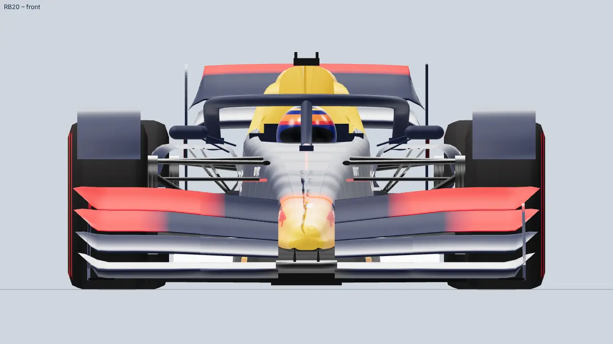
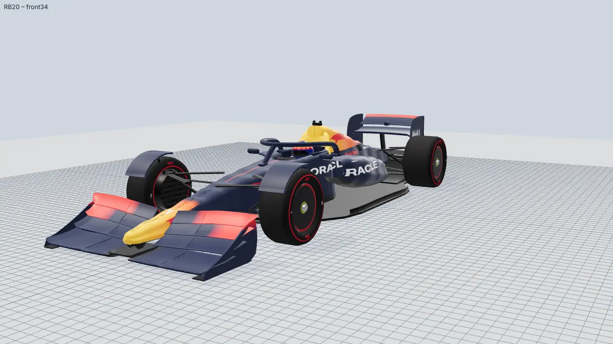
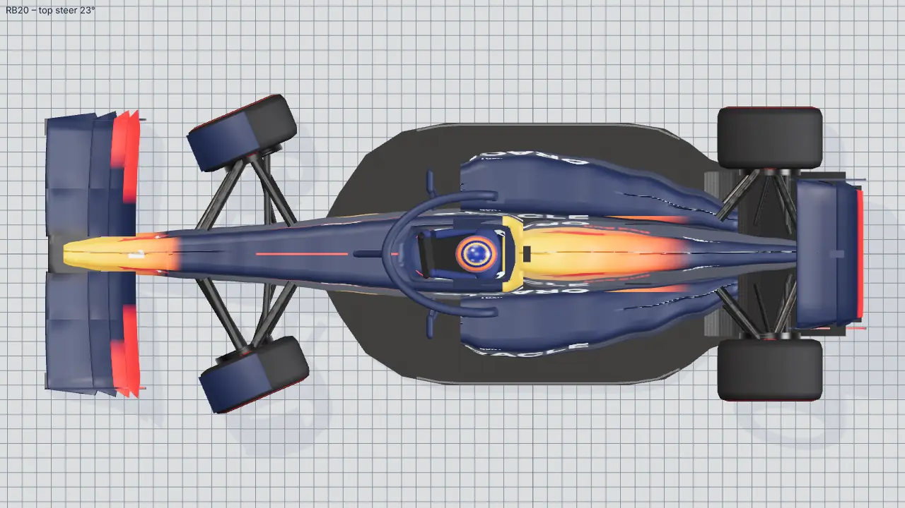
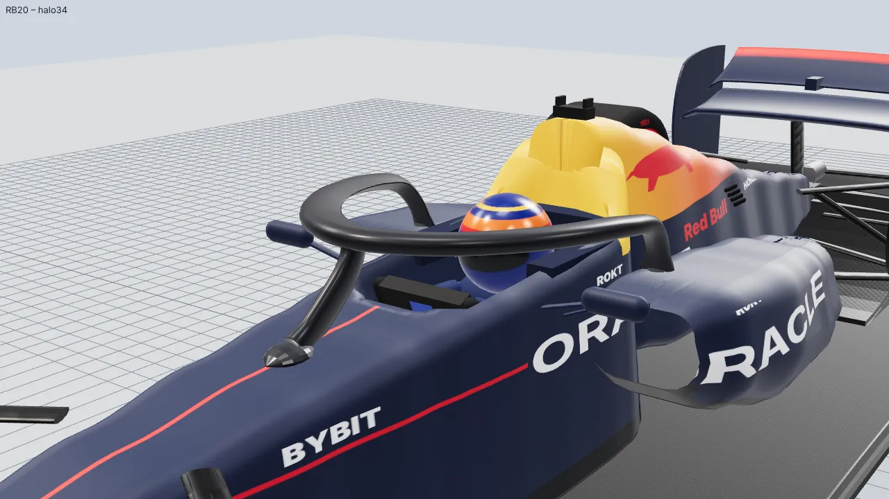
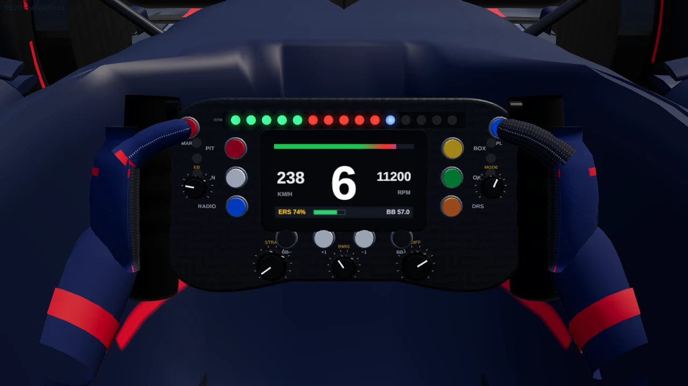
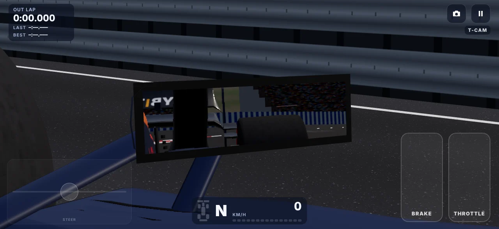

# RB20 (2024, Monaco high-downforce) — dimension sheet

All values are metres in **one coordinate system** shared by the visual model, the wheels and
steering pivots, the physics, the collision points and the cameras (`js/carspec.js`):

* origin on the ground plane (static ride height), on the car's centre line, longitudinally at
  the centre of gravity; **+x right, +y up, −z forward** (three.js convention);
* `Z.FA` = front axle (−1.946), `Z.RA` = rear axle (+1.624), `Z.fromFA(q)` = q metres behind the
  front axle.

## Provenance flags

| Flag | Meaning |
|---|---|
| **P** | Published by the manufacturer / supplier (Pirelli) |
| **R** | Regulatory bound from the 2022–25 FIA technical regulations — a *limit*, not an RB20 measurement |
| **M** | Measured from photographs, scaled by the 720 mm tyre diameter (see method) |
| **E** | Estimate from several reference views and engineering judgement |

Red Bull does not publish RB20 dimensions. No published RB20 wheelbase, length or track widths
were found; those values are photo measurements or estimates and are marked as such.

## Values

| Quantity | Value | Flag | Notes |
|---|---:|:---:|---|
| Wheelbase | 3.570 | M | Side photos give 3.51–3.56 m before foreshortening correction; regulation maximum 3.600 (R) |
| Overall length (front-wing LE → rear-wing TE) | 5.630 | M | Photo ratio length / wheelbase = 1.585 |
| Front overhang (front axle → front-wing LE) | 1.420 | M | |
| Rear overhang (rear axle → rear-wing TE) | 0.640 | M | |
| Overall width | 2.000 | R | Maximum; rear-tyre outer faces at ±1.000 |
| Front track (tyre centres) | 1.676 | E | Front tyre outer face at ±0.991 |
| Rear track (tyre centres) | 1.595 | E | Rear tyre outer face at ±1.000 |
| Front tyre | 305/720-R18 | P | Pirelli 2022–25 size: 0.305 wide, 0.720 diameter |
| Rear tyre | 405/720-R18 | P | 0.405 wide, 0.720 diameter |
| Rim | 18 in (0.457) | P | Sidewall height 0.131 |
| Loaded radius | 0.352 | E | ~8 mm static deflection |
| Nose tip ahead of the front axle | 1.270 | M | |
| Nose tip height (centre) | 0.215 | M | |
| Chassis top at the front axle | 0.505 | M | |
| Front-wing span (endplate outer faces) | 1.860 | E | Regulatory bound 2.000 (R) |
| Front-wing elements | 4 | R | Main plane + 3 flaps; Monaco flap angles 21° / 34° / 47° (E) |
| Floor width (widest) | 1.800 | E | Narrows to ±0.60 ahead of the rear tyres |
| Ride height front / rear (static, Monaco) | 0.030 / 0.060 | E | |
| Cockpit opening, front / rear edge behind the front axle | 1.050 / 1.840 | M | |
| Cockpit opening width | 0.52 | E | |
| Helmet centre behind the front axle | 1.560 | M | Helmet top 0.79 above ground |
| Halo apex (front pillar top) behind the front axle | 0.940 | M | Top of hoop 0.805 above ground |
| Halo rear mounts behind the front axle / half width | 1.700 / 0.395 | M / E | |
| Halo tube | Ø 0.049 + aero fairing | E | Faired hoop modelled as a teardrop aerofoil, 100 × 48 mm over the top (see below) |
| Airbox inlet (roll hoop front) behind the front axle | 1.790 | M | |
| Airbox / roll-hoop top | 0.950 | R / M | Height limit 950 mm, matches the photos |
| **T-cam lens** behind the front axle / height | **1.885 / 0.985** | M | Default camera position |
| Sidepod inlet behind the front axle | 1.450 | M | Narrow letterbox slot under an overbite, deep undercut |
| Rear-wing top | 0.950 | R / M | Monaco wing at the height limit |
| Rear-wing span | 1.020 | E | |
| Beam-wing height | 0.30–0.36 | E | Two elements |
| Mass (car + driver, qualifying fuel) | 805 kg | R + E | 798 kg minimum + ~7 kg fuel |
| Centre of gravity behind the front axle / height | 1.946 / 0.275 | E | 45.5 % static front weight |
| Steering lock (road wheels) | 23° | E | Monaco-specific extended lock |
| Steering pivot (kingpin) | 0.108 inboard of tyre centre | E | Through the upper/lower ball joints inside the rim |

## Method

1. **Scale.** The Pirelli tyre diameter (720 mm, published) is the known dimension. On
   near-perpendicular side photographs the horizontal tyre diameter gives pixels-per-metre at
   the wheel plane (≈ 218–222 px/m on a 1280 px image).
2. **Longitudinal stations** (axles, wing leading/trailing edges, nose tip, halo apex, helmet,
   airbox, sidepod inlet, T-cam) were read as pixel positions, converted with the wheelbase-based
   scale and cross-checked on a second photograph (Austria 2024 and Japan 2024 side views).
3. **Heights.** Photographers stand above the car, so items on the centre line (≈ 0.84 m behind
   the near tyre's plane) appear higher than they are. The camera elevation was estimated from
   the far front tyre showing above the near one (7–10°) and heights were corrected by
   `depth × tan(elevation)`. After correction the airbox (0.95 m), nose tip (0.20 m) and helmet
   (0.80 m) agree with the model within ~2–3 cm.
4. **Widths** cannot be measured from side views; they come from the regulations (overall width,
   front-wing bound) and the Pirelli widths, and are flagged **E**.
5. **Validation.** The orthographic side render of the model was overlaid on a mirrored,
   scaled reference photograph aligned at the front axle: both axles, the front-wing leading
   edge, the rear-wing trailing edge, the nose-tip height and the airbox height line up.

Reference photographs (Wikimedia Commons, used only for measurement, not shipped):
`FIA_F1_Austria_2024_Nr._1_Verstappen_(side).jpg`,
`RB20_No.1_Chinese_GP_2024_3be31a22d7ad225cab53e070a0c8bfc.jpg`,
`Red_Bull_RB20_No.1_B32dce58209dcfc99e9b27d1d47a568.jpg`,
`RB20_During_the_2024_Japanese_Free_Practice.jpg`,
`2024_Spanish_Grand_Prix_(53810018852).jpg`.

## Validation views

| | |
|---|---|
| Side  | Front  |
| Top  | Rear three-quarter  |
| Front three-quarter  | Onboard (T-cam, model only)  |

**Full lock (23°).** Top view with the front wheels at full Monaco lock: the inner tyre keeps
clear of the nose, the front wing endplate and the chassis; wishbones, track rod, pull-rod and the
wheel-wake winglets follow the upright.

**Front wing from the T-cam.** From the default camera the front wing is mostly hidden by the
nose and the front tyres: only the red trailing edges of the two upper flaps show beside the
nose, roughly 3.3 m ahead and 12° below the horizon. Mobile quality settings never simplify the
halo, nose, front tyres, wheel-wake winglets, mirrors or front suspension (everything visible
above the halo); reductions apply to scenery, fences, shadows and resolution.

## Cross-sections that matter from the onboard view

* **Nose:** 12 × 9 cm rounded tip at 0.215 m, widening to 0.40 m and 0.30 m tall at the front
  axle, flat underside, top rising to 0.505 m.
* **Front wing:** inverted cambered profiles with thick leading edges (8–10 % thickness) and
  thin trailing edges (0.6 % finite TE); flap gaps of 1–2 cm; tips curl up into the endplates.
* **Suspension:** aerofoil-section links (chord 35–80 mm, thickness 16–30 mm) between chassis
  pick-ups and ball joints inside the rim; one instanced mesh, updated every frame.
* **Halo:** the 49 mm titanium tube under a carbon aero fairing. The hoop is swept with a
  teardrop aerofoil section (NACA-type thickness form, leading edge facing out / forward, tail
  towards the cockpit, 5.7° nose-down): **102 × 48 mm over the top and front**, narrowing to the
  faired tube on the rear legs (64 × 48 mm) and flaring to ~99 × 55 mm into the mounts. The
  **central pillar** is an aerofoil blade with its chord along the airflow (78–110 mm chord,
  36–54 mm thick); it rises vertically into the hoop so its end section sits inside the hoop's
  aerofoil, with a fillet that widens towards the top, and curves forward onto a streamlined,
  bolted **mounting pad** on the chassis ahead of the cockpit (170 × 105 mm). The rear legs land
  on faired shoulder mounts (190 × 95 mm). Material: dark woven carbon (2×2 twill, ~4 mm tows,
  UVs along the hoop) under a satin lacquer (clear coat 0.55, roughness 0.22) with reduced
  environment reflection, so it reads as carbon — not chrome — at the grazing T-cam angle.
  Checked from the T-cam, the cockpit, front, side, three-quarter and rear views
  (`node tools/shots.mjs out halo34,haloside,halorear,halofront,pillarback,tcam,cockpit`).

  

## Livery and materials

Matte navy body (roughness 0.5), red pin-stripes, yellow-to-orange nose tip and airbox with red
charging-bull silhouettes, carbon weave (normal-mapped, roughness 0.3) on exposed carbon,
lacquered carbon halo (clear coat), matte carbon floor and floor fences, rubber tyres
(roughness 0.9) with soft-compound red markings and machined rim lips, metallic titanium
hardware (metalness 0.95), glossy helmet. The driver's helmet is a generic design.

**Sponsor wordmarks** are conformal decals (`js/decals.js`): each name is drawn into its own
texture at 2,200–4,000 px/m and projected onto the body triangles it covers (filtered by
surface normal, so a side decal never wraps onto a top surface), offset 0.7 mm with polygon
offset, and parented to the part it sits on (it breaks away with that part). Positions follow
2024 RB20 photos: ORACLE on both sidepods and the rear-wing main plane, Bybit on the tub, the
front-wing endplates and the rear-wing flap, Red Bull on the engine cover, Honda behind it,
ROKT on the cockpit shoulder, Rauch on the tub side, Mobil 1 on the nose and the rear-wing
endplates, and ORACLE on the halo's top (the halo sponsor could not be verified from a
2024 source in this environment). They are text approximations in a similar weight and
proportion, not the real logo artwork.

## Cockpit: steering wheel, hands and arms (`js/cockpit.js`)

* **Wheel:** 270 × 160 mm carbon body (extruded outline with rounded grips) on a 4.4 : 1
  steering ratio — 23° road-wheel lock = ±101° at the wheel. Suede-wrapped grips, 82 × 46 mm
  digital display (gear, speed, rpm bar, ERS state of charge, brake bias / LOCK) redrawn at
  ~15 Hz only when something visible changes, 15 shift LEDs (green 9,600 rpm → red → blue at the
  shift point, all blue flashing on the limiter) and 6 side LEDs (amber while a tyre locks or
  spins, white in neutral), 12 labelled buttons with alloy rims, 5 knurled rotaries with printed
  scales (STRAT, DIFF, BMIG, EB, MODE), thumb wheels, upshift / downshift and clutch paddles,
  quick-release hub. Static parts are merged per material (one draw call each).
* **Hands:** gloves modelled round the grips (palm shell, four fingers and thumb as capped
  tubes, cuff with a red strap), knit glove texture with stitched seams. They are children of
  the wheel, so they turn with it exactly.
* **Arms:** upper arm 0.28 m, forearm 0.26 m, two-bone IK every frame from the shoulders (just
  ahead of the helmet) to each wrist, elbows biased outward-down; the reach stays within the
  arm length over the full ±101°, so the hands never detach or stretch.
* **Direction:** steering right turns the wheel clockwise as seen by the driver, the front
  wheels right and the car right (checked by the acceptance test).

  

## Mirrors (`js/carmodel.js`, `js/mirrors.js`)

* Reflective surface **200 × 50 mm** (the 2023-onwards minimum width), glass centre 0.49 m
  from the centre line, 0.66 m high, 1.20 m behind the front axle, above the sidepod inlet.
* Glass normal halfway between the direction to the driver's eye and straight back, so the
  driver sees the car's flank on the inboard edge and the track behind.
* Housing lofted from rounded-rectangle sections (≈ 220 × 70 mm, 82 mm deep); two **blade**
  stays (46 × 9 mm and 26 × 7 mm sections) from the chassis shoulder end inside the housing
  ahead of the glass plane, so nothing crosses the line of sight to the glass.
* Reflection: real-time planar reflector per glass (generalised off-axis projection through the
  glass rectangle, near plane on the glass), half-float render target 256 × 88 (High),
  192 × 66 (Medium), 128 × 44 (Low), the two glasses refreshed on alternate frames, skipped when
  off-screen or seen from behind, no shadow-map update in the mirror pass.

  
