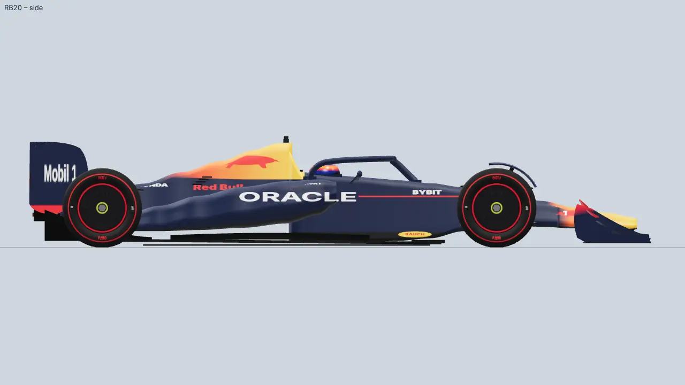
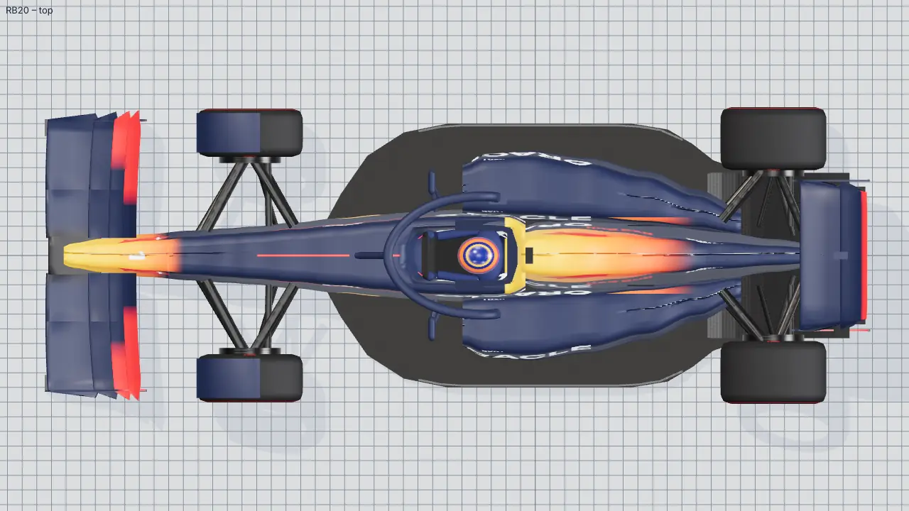
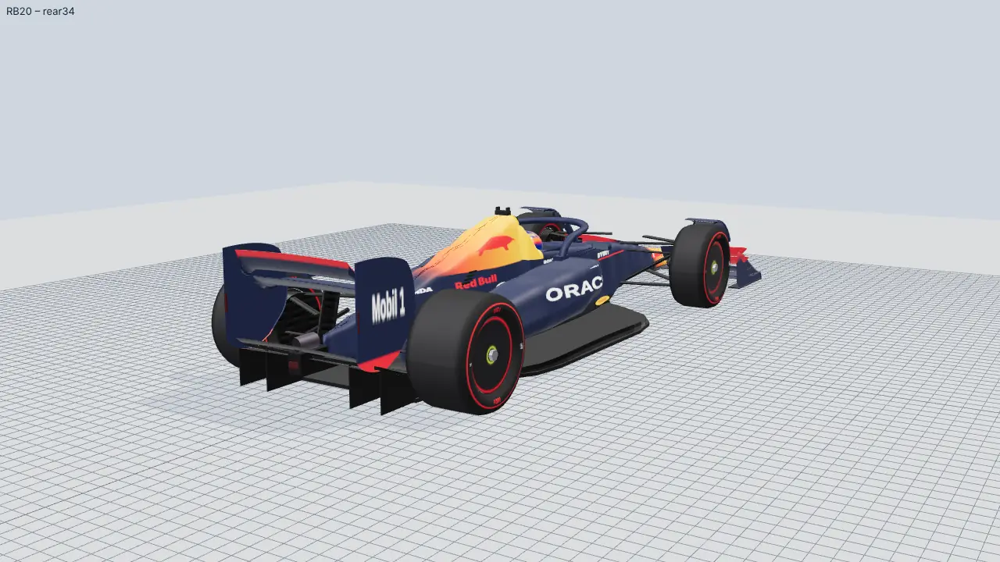
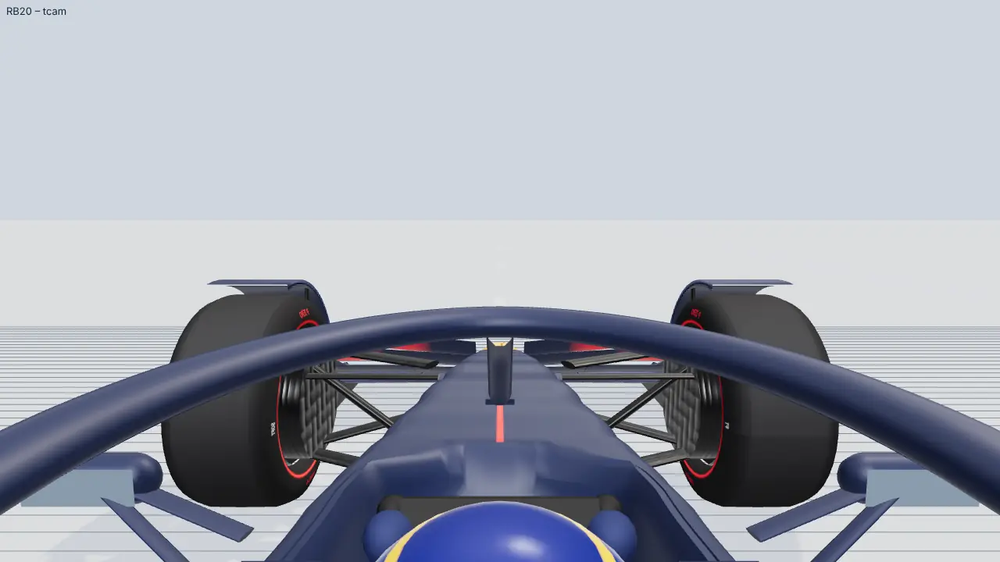
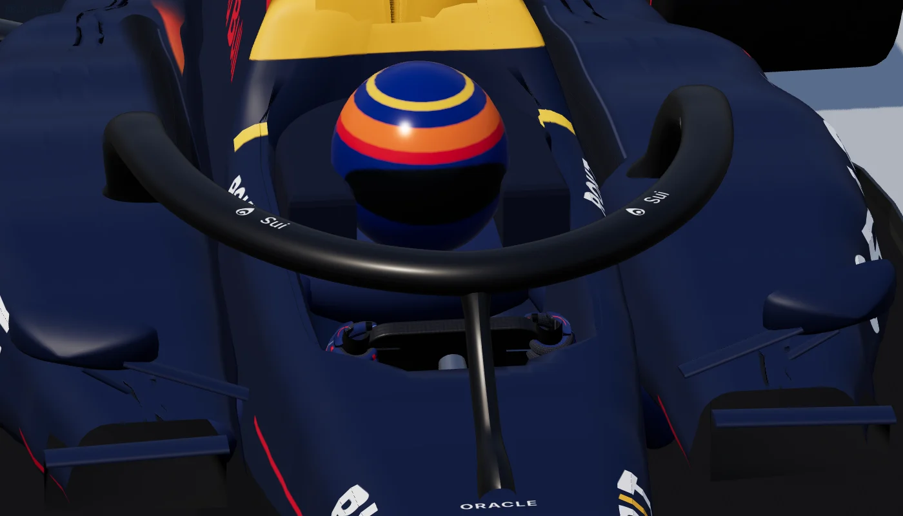
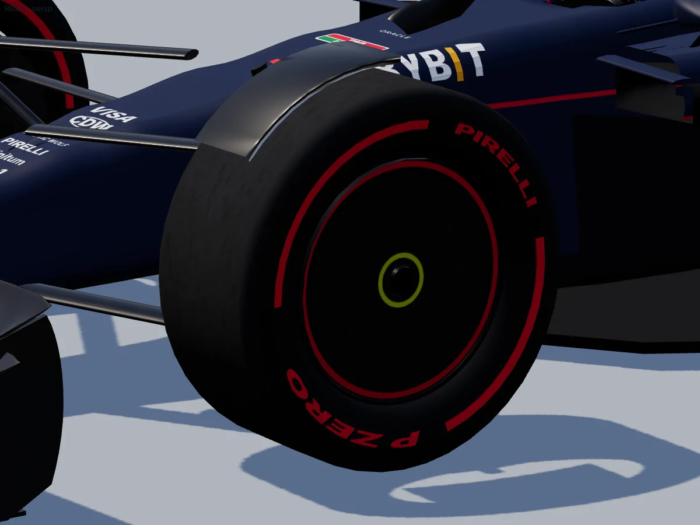

# RB20 (2024, Monaco high-downforce) — dimension sheet

All values are metres in **one coordinate system** shared by the visual model, the wheels and
steering pivots, the physics, the collision points and the cameras (`js/carspec.js`):

* origin on the ground plane (static ride height), on the car's centre line, longitudinally at
  the centre of gravity; **+x right, +y up, −z forward** (three.js convention);
* `Z.FA` = front axle (−1.946), `Z.RA` = rear axle (+1.624), `Z.fromFA(q)` = q metres behind the
  front axle.

## Provenance flags

| Flag | Meaning |
|---|---|
| **P** | Published by the manufacturer / supplier (Pirelli) |
| **R** | Regulatory bound from the 2022–25 FIA technical regulations — a *limit*, not an RB20 measurement |
| **M** | Measured from photographs, scaled by the 720 mm tyre diameter (see method) |
| **E** | Estimate from several reference views and engineering judgement |

Red Bull does not publish RB20 dimensions. No published RB20 wheelbase, length or track widths
were found; those values are photo measurements or estimates and are marked as such.

## Values

| Quantity | Value | Flag | Notes |
|---|---:|:---:|---|
| Wheelbase | 3.570 | M | Side photos give 3.51–3.56 m before foreshortening correction; regulation maximum 3.600 (R) |
| Overall length (front-wing LE → rear-wing TE) | 5.630 | M | Photo ratio length / wheelbase = 1.585 |
| Front overhang (front axle → front-wing LE) | 1.420 | M | |
| Rear overhang (rear axle → rear-wing TE) | 0.640 | M | |
| Overall width | 2.000 | R | Maximum; rear-tyre outer faces at ±1.000 |
| Front track (tyre centres) | 1.676 | E | Front tyre outer face at ±0.991 |
| Rear track (tyre centres) | 1.595 | E | Rear tyre outer face at ±1.000 |
| Front tyre | 305/720-R18 | P | Pirelli 2022–25 size: 0.305 wide, 0.720 diameter |
| Rear tyre | 405/720-R18 | P | 0.405 wide, 0.720 diameter |
| Rim | 18 in (0.457) | P | Sidewall height 0.131 |
| Loaded radius | 0.352 | E | ~8 mm static deflection |
| Nose tip ahead of the front axle | 1.270 | M | |
| Nose tip height (centre) | 0.215 | M | |
| Chassis top at the front axle | 0.505 | M | |
| Front-wing span (endplate outer faces) | 1.860 | E | Regulatory bound 2.000 (R) |
| Front-wing elements | 4 | R | Main plane + 3 flaps; Monaco flap angles 21° / 34° / 47° (E) |
| Floor width (widest) | 1.800 | E | Narrows to ±0.60 ahead of the rear tyres |
| Ride height front / rear (static, Monaco) | 0.030 / 0.060 | E | |
| Cockpit opening, front / rear edge behind the front axle | 1.050 / 1.840 | M | |
| Cockpit opening width | 0.52 | E | |
| Helmet centre behind the front axle | 1.560 | M | Helmet top 0.852 above ground (level with the halo arm in the 2024 side photo); driver's eye 0.756 |
| Halo apex (front pillar top) behind the front axle | 0.940 | M | Top of hoop 0.805 above ground |
| Halo rear mounts behind the front axle / half width | 1.700 / 0.395 | M / E | |
| Halo tube | Ø 0.049 + aero fairing | E | Faired hoop: rounded D section ~74 × 56 mm over the front, ~90 × 66 mm on the legs (see below) |
| Airbox inlet (roll hoop front) behind the front axle | 1.790 | M | |
| Airbox / roll-hoop top | 0.950 | R / M | Height limit 950 mm, matches the photos |
| **T-cam lens** behind the front axle / height | **1.885 / 0.985** | M | Default camera position |
| Sidepod inlet behind the front axle | 1.000 | M | Narrow letterbox slot under an overbite, just behind the mirrors; full width by ~1.6 m; deep undercut (2024 side photo) |
| Rear-wing top | 0.950 | R / M | Monaco wing at the height limit |
| Rear-wing span | 1.020 | E | |
| Beam-wing height | 0.30–0.36 | E | Two elements |
| Mass (car + driver, qualifying fuel) | 805 kg | R + E | 798 kg minimum + ~7 kg fuel |
| Centre of gravity behind the front axle / height | 1.946 / 0.275 | E | 45.5 % static front weight |
| Steering lock (road wheels) | 23° | E | Monaco-specific extended lock |
| Steering pivot (kingpin) | 0.108 inboard of tyre centre | E | Through the upper/lower ball joints inside the rim |

## Method

1. **Scale.** The Pirelli tyre diameter (720 mm, published) is the known dimension. On
   near-perpendicular side photographs the horizontal tyre diameter gives pixels-per-metre at
   the wheel plane (≈ 218–222 px/m on a 1280 px image).
2. **Longitudinal stations** (axles, wing leading/trailing edges, nose tip, halo apex, helmet,
   airbox, sidepod inlet, T-cam) were read as pixel positions, converted with the wheelbase-based
   scale and cross-checked on a second photograph (Austria 2024 and Japan 2024 side views).
3. **Heights.** Photographers stand above the car, so items on the centre line (≈ 0.84 m behind
   the near tyre's plane) appear higher than they are. The camera elevation was estimated from
   the far front tyre showing above the near one (7–10°) and heights were corrected by
   `depth × tan(elevation)`. After correction the airbox (0.95 m), nose tip (0.20 m) and helmet
   (0.80 m) agree with the model within ~2–3 cm.
4. **Widths** cannot be measured from side views; they come from the regulations (overall width,
   front-wing bound) and the Pirelli widths, and are flagged **E**.
5. **Validation.** The orthographic side render of the model was overlaid on a mirrored,
   scaled reference photograph aligned at the front axle: both axles, the front-wing leading
   edge, the rear-wing trailing edge, the nose-tip height and the airbox height line up.

Reference photographs (Wikimedia Commons, used only for measurement, not shipped):
`FIA_F1_Austria_2024_Nr._1_Verstappen_(side).jpg`,
`RB20_No.1_Chinese_GP_2024_3be31a22d7ad225cab53e070a0c8bfc.jpg`,
`Red_Bull_RB20_No.1_B32dce58209dcfc99e9b27d1d47a568.jpg`,
`RB20_During_the_2024_Japanese_Free_Practice.jpg`,
`2024_Spanish_Grand_Prix_(53810018852).jpg`.

## Validation views

| | |
|---|---|
| Side  | Front  |
| Top  | Rear three-quarter  |
| Front three-quarter  | Onboard (T-cam, model only)  |

**Full lock (23°).** Top view with the front wheels at full Monaco lock: the inner tyre keeps
clear of the nose, the front wing endplate and the chassis; wishbones, track rod, pull-rod and the
wheel-wake winglets follow the upright.

**Front wing from the T-cam.** From the default camera the front wing is mostly hidden by the
nose and the front tyres: only the red trailing edges of the two upper flaps show beside the
nose, roughly 3.3 m ahead and 12° below the horizon. Mobile quality settings never simplify the
halo, nose, front tyres, wheel-wake winglets, mirrors or front suspension (everything visible
above the halo); reductions apply to scenery, fences, shadows and resolution.

## Cross-sections that matter from the onboard view

* **Nose:** 12 × 9 cm rounded tip at 0.215 m, widening to 0.40 m and 0.30 m tall at the front
  axle, flat underside, top rising to 0.505 m.
* **Front wing:** inverted cambered profiles with thick leading edges (8–10 % thickness) and
  thin trailing edges (0.6 % finite TE); flap gaps of 1–2 cm; tips curl up into the endplates.
* **Suspension:** aerofoil-section links (chord 35–80 mm, thickness 16–30 mm) between chassis
  pick-ups and ball joints inside the rim; one instanced mesh, updated every frame.
* **Halo** (`js/halo.js`, rebuilt from 2024 photos): the titanium structure under a
  satin-black fairing. The hoop has a **rounded D section, ~74 × 56 mm** over the front — fully
  rounded outboard, flatter on the inboard face where the small markings are printed — growing
  to ~90 × 66 mm on the rear legs, which flare (~136 × 96 mm) where they enter the bodywork at
  the cockpit shoulders; no separate mounting pads. The **centre pillar** is a swept blade (lens
  section, chord along the flow, 84–86 mm chord, 34–54 mm thick) rising from a long fillet on
  the chassis ahead of the cockpit into the front of the hoop. Material: satin black (base
  colour #101115, roughness 0.46, clear coat 0.55 / 0.26) - in photos the 2024 halo fairing
  reads as satin black rather than as visible weave.

  **Markings** (white unless stated), placed from 2024 photos (see *References* below):
  "◇ Sui" on top of each arm, ~0.32 m from the front along the hoop (right arm reads forward,
  left arm rearward; both read left-to-right for a viewer in front of the car); on the inner
  face of the left arm, reading forward: @REDBULLRACING (rear), BYBIT, ORACLE (front corner);
  on the inner face of the right arm, reading rearward: ZOOM, @REDBULLRACING; a TAG Heuer
  shield on the driver-facing side of the hoop front, either side of the pillar. A word beside
  the right-hand shield is unreadable in every reference and was left out (no guessed
  sponsors, no repeated logos to fill space). The markings are a second skin generated from
  the hoop's own surface parameterisation (arc length × angle round the section), offset
  0.6 mm along the surface normal, in one 4,600 px/m mipmapped atlas: they follow the curvature
  exactly, cannot come out mirrored, and stay attached from every camera.

  
* **Tyres** (18-inch, `tyreGeometry`): flat running surface with a 1.5 mm crown, 26 mm
  shoulder radius, sidewall flaring out of the rim flange and bulging ~8 mm past the tread
  width. 2024 Pirelli sidewall art (soft compound, red): "P ZERO" and "PIRELLI" arched round the
  upper sidewall between two thick compound-colour arcs, reading clockwise from each side with
  the letters' tops towards the tread. Roughness map: scrubbed tread 0.93, satin sidewall 0.74;
  tread graining. The lettering cross-fades to a circumferentially averaged copy with wheel
  speed (fully smeared from ~65 km/h), so it blurs into rings instead of strobing.

  

## Livery and materials

Each material class answers sunlight differently (and the outdoor / tunnel environment maps in
`js/envmap.js` give them something real to reflect): **satin navy paint** (#16213f, roughness
0.52, broad soft sheen; sampled sun-lit sidepod in the Austria photo ≈ sRGB 33/32/30, the model
renders ≈ L* 11), **exposed carbon** (front and rear wings, suspension, floor details: dark
weave under a hard clear coat, roughness 0.40 + clear coat 1.0 / 0.07 → sharp sky reflections;
the weave normal is subtle, 0.16, so it reads as carbon at driving distance without a busy
pattern), a **matte carbon floor** (roughness 0.80), the **satin-black halo**, **rubber**
(roughness map, no sheen except at grazing angles) and **metal** (titanium 0.95 metalness,
black-anodised wheel nut). Livery: yellow-to-orange nose tip; the airbox / engine-cover
yellow → orange → red field whose lower edge sweeps from 0.80 m at the airbox down to 0.60 m
at the rear (Austria side photo), with the red bull; the navy field below carries the red
"Red Bull" wordmark; the sidepod undercut is a dark recess. The driver's helmet is a generic
design.

**Sponsor wordmarks** are conformal decals (`js/decals.js`): each artwork is drawn at
1,400–3,600 px/m, packed into one shared 4,096 px atlas, projected onto the body triangles it
covers (filtered by surface normal, clipped exactly to the decal rectangle), offset 0.7 mm with
polygon offset, and merged per car part (one draw call per part; a decal breaks away with its
part). Positions were measured on 2024 photos - the side view overlaid with the model rendered
in the same telephoto perspective, and the front close-ups: ORACLE (1.06 m long) across the
sidepod with SIEMENS under its rear, Bybit on the chassis side ahead of the sidepod, ROKT on the
cockpit side under the halo leg, the red Red Bull wordmark on the navy engine-cover side, HONDA
behind it, Rauch (orange-yellow oval) low on the chassis side; on the chassis top, read from
the front: ORACLE ahead of the halo pillar, the TAG Heuer badge, the red car number 1, and the
nose stack VISA / CDW / zoom / ARCTIC WOLF / PIRELLI / infinitum / Mobil 1; on the carbon front
wing "Red" (right half) and "Bull" (left) in red with Bybit on the flaps; a large Bybit on the
rear-wing flap. They are text approximations in a similar weight and proportion, not the real
logo artwork.

## Cockpit: steering wheel, hands and arms (`js/cockpit.js`)

* **Wheel:** 270 × 160 mm carbon body (extruded outline with rounded grips) on a 4.4 : 1
  steering ratio — 23° road-wheel lock = ±101° at the wheel. Suede-wrapped grips, 82 × 46 mm
  digital display (gear, speed, rpm bar, ERS state of charge, brake bias / LOCK) redrawn at
  ~15 Hz only when something visible changes, 15 shift LEDs (green 9,600 rpm → red → blue at the
  shift point, all blue flashing on the limiter) and 6 side LEDs (amber while a tyre locks or
  spins, white in neutral), 12 labelled buttons with alloy rims, 5 knurled rotaries with printed
  scales (STRAT, DIFF, BMIG, EB, MODE), thumb wheels, upshift / downshift and clutch paddles,
  quick-release hub. Static parts are merged per material (one draw call each).
* **Hands:** gloves modelled round the grips (palm shell, four fingers and thumb as capped
  tubes, cuff with a red strap), knit glove texture with stitched seams. The grip, the palm and
  the fingers are all built from one grip-surface function (elliptical section, toed in, with
  moulded grooves under the fingers), so the fingers lie on the grip: measured gap between the
  glove and the grip surface median 8 mm (finger centrelines) / 5th percentile 0.4 mm, no
  penetration beyond 1.5 mm. They are children of the wheel, so they turn with it exactly.
* **Shift LEDs:** smoked dark lenses when off; lit LEDs get an additive glow halo, so they stay
  readable in direct sun as on onboard footage.
* **Arms:** upper arm 0.28 m, forearm 0.26 m, two-bone IK every frame from the shoulders (just
  ahead of the helmet) to each wrist, elbows biased outward-down; the reach stays within the
  arm length over the full ±101°, so the hands never detach or stretch.
* **Direction:** steering right turns the wheel clockwise as seen by the driver, the front
  wheels right and the car right (checked by the acceptance test).

  

## Driver's eye and cockpit camera

The 2024 side photos (Austria) put the top of the driver's helmet level with the halo arm, so
the helmet top is at 0.852 m and the **eye at 0.756 m**, 1.47 m behind the front axle (shoulders,
headrest and arm pivots follow). The cockpit camera has a helmet-camera field of view (80°
vertical in 16:9, ~112° across): the halo crossbar runs across the top of the frame with its
markings, the pillar sits in the middle ahead of the nose, both front tyres show beside the
nose, the steering wheel with its LEDs and display fills the bottom, and **both mirrors sit at
the frame edges**. In the cockpit view the HUD panel moves to the top centre (smaller), because
the wheel's own display shows gear and speed. (No onboard video could be fetched in this
environment; the relationships were checked against the photos.)

## Mirrors (`js/carmodel.js`, `js/mirrors.js`)

* Reflective surface **200 × 50 mm** (the 2023-onwards minimum width), glass centre 0.515 m
  from the centre line, 0.668 m high, **1.13 m behind the front axle** (2024 side photo: the
  housing spans ~1.02–1.16 m, just ahead of the sidepod inlet's overbite).
* Aimed as a driver sets it: from the eye, the centre of the glass looks back 4° outboard and
  1.5° up - a sliver of the car's flank on the inboard edge, the track behind above the rear
  tyre. The glass is slightly convex (field widened ×1.55 horizontally, ×1.30 vertically about
  its centre) and reflects ~80 % neutrally (no tint).
* Housing lofted from rounded-rectangle sections (≈ 220 × 70 mm, 82 mm deep); two **blade**
  stays (46 × 9 mm and 26 × 7 mm sections) from the chassis shoulder end inside the housing
  ahead of the glass plane, so nothing crosses the line of sight to the glass.
* Reflection: real-time planar reflector per glass (generalised off-axis projection through the
  glass rectangle, near plane on the glass, far plane 320 m), half-float render target 384 × 96
  (High), 256 × 64 (Medium), 160 × 40 (Low) - 8-bit sRGB where the GPU cannot render to half
  float - the two glasses refreshed on alternate frames, skipped when off-screen or seen from
  behind, no shadow-map update in the mirror pass, and the driver, steering wheel and arms
  (render layer 1, never visible in the mirrors) skipped.

  

## References (2024 photos used for this pass)

Measured on these Wikimedia Commons photos (CC BY-SA 4.0; not redistributed here). No
photos from the 2024 Monaco Grand Prix itself were available to this environment; the halo
fairing, its markings, the tyres and the livery were the same across these 2024 races, while
the Monaco high-downforce rear wing follows the earlier dimension sheet.

* Front close-up, halo and chassis-top markings: "FIA F1 Austria 2024 Nr. 1 Verstappen (misc)",
  Lukas Raich - https://commons.wikimedia.org/wiki/File:FIA_F1_Austria_2024_Nr._1_Verstappen_(misc).jpg
* Side view: halo arms, eye height, sidepod, livery and decal positions, tyres: "FIA F1 Austria
  2024 Nr. 1 Verstappen (side)", Lukas Raich - https://commons.wikimedia.org/wiki/File:FIA_F1_Austria_2024_Nr._1_Verstappen_(side).jpg
* Halo inner faces from above: "BelgianGP24-MaxVerstappen-1 (cropped)", Thekuner -
  https://commons.wikimedia.org/wiki/File:BelgianGP24-MaxVerstappen-1_(cropped).jpg
* Halo top (Sui) and front: "Max Verstappen in the RB20" (Suzuka), Cineyas -
  https://commons.wikimedia.org/wiki/File:Max_Verstappen_in_the_RB20.jpg
* Garage front view (nose, front wing): "2024-08-25 … Großer Preis der Niederlande 2024 STP 3630",
  Steffen Prößdorf - https://commons.wikimedia.org/wiki/File:2024-08-25_Motorsport,_Formel_1,_Gro%C3%9Fer_Preis_der_Niederlande_2024_STP_3630_by_Stepro.jpg
