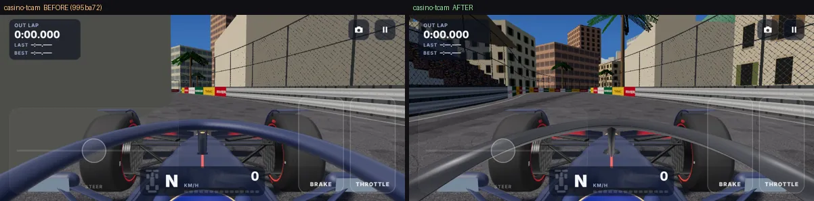
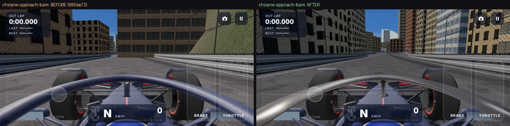

# Testing report

## What was tested, and how

All testing so far ran in a cloud container **without a physical phone and without a GPU**:
Chromium (Playwright) with mobile emulation and software WebGL (SwiftShader). There is no WebKit
engine in the container, so **iPhone Safari itself has not been exercised** — the iPhone runs
below use Chromium with the iPhone 15 Pro Max user agent, viewport (956 × 440 CSS px landscape,
the size of the Pro Max class including the iPhone 18 Pro Max) and touch emulation.

| Test | Environment | Result |
|---|---|---|
| Acceptance checks (`tools/gameplay-test.mjs`) | Emulated iPhone (956 × 440, touch, iOS UA), Chromium 1243 + SwiftShader | 36 / 36 pass |
| Acceptance checks | Emulated Android Chrome (Pixel 7, 915 × 412, touch) | 36 / 36 pass |
| Circuit inspection (`tools/inspect-circuit.mjs`) | Chromium, rendered scene, High / Medium / Low tiers | all 7 checks pass on every tier, self-test catches planted faults |
| Zero-steering straight line (`tools/straight-line-test.mjs`) | Node.js physics | 10 / 10 pass |
| Tunnel transitions (`tools/tunnel-test.mjs`) | Chromium, autopilot through the tunnel | smooth: max 0.011 exposure change per frame |
| Physics laps (`tools/sim-lap.mjs 3`) | Node.js | 3 autopilot laps, 0 contacts, 79.0 s |

Run them yourself:

```bash
node tools/serve.mjs 8080                    # local server
node tools/gameplay-test.mjs out iphone      # 36 acceptance checks (emulated)
node tools/gameplay-test.mjs out android
BASE_URL=https://loyoso34.github.io/Monaco-F1-Mobile/ node tools/gameplay-test.mjs out iphone   # against the live site
node tools/inspect-circuit.mjs               # circuit inspection, all graphics tiers (exit code 1 on failure)
node tools/straight-line-test.mjs            # zero steering / barrier brushes (exit code 1 on failure)
node tools/tunnel-test.mjs out               # tunnel lighting time series + frames
node tools/views.mjs out all                 # screenshots at the inspection spots, tunnel, halo
node tools/sim-lap.mjs 3                     # headless physics laps
node tools/track-report.mjs                  # circuit geometry checks
node tools/perf-probe.mjs                    # draw calls, CPU per frame, memory over laps
```

## Circuit inspection (`tools/inspect-circuit.mjs`)

Runs inside the page against the scene as rendered (world-space triangles), for each graphics
tier, using the track exclusion corridor (`js/corridor.js`):

1. **Raster** — every point 1 m inside the barriers of every section is marked as circuit
   (158,798 points, 0 holes).
2. **Track** — no barrier line of one section lies on the road or run-off of another section.
3. **Terrain** — the terrain mesh stays below the road, run-off and pavement surface everywhere
   (254,165 samples under the circuit).
4. **Objects** — no scenery triangle (buildings, landmarks, Fairmont, grandstands, garages,
   yachts, palms) enters the drivable volume: inside the barrier lines, from the road surface up
   to 5 m (≈ 3.5 million sample points every 0.5 m on the ~1,500 triangles near the circuit;
   cells that straddle a barrier are resolved exactly against the sections).
5. **Pavements** — no building stands on a pavement.
6. **Footprints** — no two building / landmark footprints overlap.
7. **Bases** — no building floats above the rendered terrain along its perimeter.

A **self-test** then plants a 4 m box on the racing line at Tabac and lifts one terrain vertex
through the road at Mirabeau; the inspection must report both (it does: 552 and 351 hits).

| | Previous release (995ba72) | Now |
|---|---|---|
| Terrain above the road / run-off / pavement | **16,430** samples, worst **36.6 m** above the road (Anthony Noghès 6,500 / worst 36.6 m, Rascasse 3,429 / 26.4 m, Tabac 2,575 / 10.4 m, Mirabeau Bas 1,703 / 4.6 m, Nouvelle Chicane 1,082 / 13.5 m, hairpin 1,016 / 2.5 m, Mirabeau, pool) | **0** |
| Scenery inside the drivable volume | **9,142** sample points (Nouvelle Chicane 3,999, Tabac 3,077, Massenet 943, Casino 918, Mirabeau 205) | **0** |
| Building points on pavements | **66,840** (every sector) | **0** |
| Overlapping footprints / floating bases | not tracked | **0 / 0** |

Before / after screenshots of the same camera positions (old build served from a worktree with
the same debug camera hook) show the causes: a building across the road at the Nouvelle Chicane,
half the view at Casino Square blocked by a building, grassy terrain rising over the barriers at
Tabac and Rascasse, and the black strip and wall-to-wall advertising in the tunnel.





## Zero steering / straight line (`tools/straight-line-test.mjs`, acceptance checks)

* **Root cause of the reported pull to the right:** light barrier brushes (a tyre or rim touching
  the wall, ~800–2,500 J) bent the suspension silently: 800 J on the front-right wheel left
  −0.40° of toe at HUD damage level 0, i.e. an invisible 6 m drift to the right within 6 s.
  Wheels now absorb brushes below 3.5 kJ elastically, and alignment only changes once the corner
  is visibly damaged on the HUD; a bent link stays bent the same way.
* **Touch input:** a 3.5 % dead zone around the thumb's touch-down point and an exact snap to 0
  when the target is 0, so a resting or trembling thumb steers nothing and released steering
  returns to exactly 0.
* **Results:** flat straight road, full throttle from rest for 8 s with zero steering from d = 0
  and ±1.6 m: heading change 0.00000°, lateral drift 0.0000 m, yaw rate 0. Brushes of 800–3,500 J
  on each wheel: toe 0.00°, camber 0.00°, no drift. A hard 9 kJ wheel strike bends the
  suspension visibly (HUD level 1, toe −0.70°). In the game (acceptance checks): released
  steering returns to exactly 0; tremor inside the dead zone gives 0; throttle only for 1.5 s
  gives 74 km/h with steering 0, heading change −0.0006° and yaw rate 0.0006°/s.
* **Start position:** the start / finish straight is a long right-hand curve (R ≈ 215–1000 m).
  The car now starts in the second grid slot on the right-hand side, 16 m before the line, where
  a car held perfectly straight runs ~120 m (4.2 s, ~200 km/h) before reaching the left-hand
  side — previously it started in the tightest part of the bend and met the left wall after 45 m.
  The car's own heading never changes without steering (0.002° after 84 m).

## Tunnel lighting transitions (`tools/tunnel-test.mjs`)

The autopilot drives Portier → tunnel → Nouvelle Chicane (no rendering, real-time simulation,
774 frames); then a rendered run captures frames at the entrance, inside and at the exit.

| Measure | Result |
|---|---|
| Exposure outside → inside | 1.00 → 1.31 (the tunnel stays a little darker than daylight) |
| Daylight on the car inside / sun inside | 0 / ≤ 3 % (the shell's shadow does the rest on High / Medium) |
| Entry: exposure 95 % adapted | 1.8 s after the portal (66 m in at ~150 km/h) |
| Exit: peak exposure / settled within 2 % | 1.24 at the portal / 0.75 s after it |
| Largest exposure change between frames | 0.011 (no visible steps) |

## Visual checks (`tools/views.mjs`, `tools/shots.mjs`, `tools/tour.mjs`)

Fixed and onboard cameras at the start straight, Sainte Dévote, Beau Rivage, Casino, Mirabeau,
the hairpin, Portier, the tunnel (entry, ceiling, walls, mid-tunnel from T-cam, cockpit and
chase, exit, both portals, the Fairmont from above and from the sea), the Nouvelle Chicane,
Tabac, the swimming pool and Rascasse; a 31-stop T-cam tour of the whole lap; the halo from
the T-cam, the cockpit, three-quarter, side, front, rear and close-ups of the pillar junction.

## Acceptance checks (`tools/gameplay-test.mjs`)

Cold launch (loading screen → menu with Drive and Settings) · default camera is the T-cam · car
spawns before the line with timing stopped · touch targets kept ≥ 18 px from the edges ·
steering starts anywhere in its zone and works while the throttle is held · sliding the throttle
thumb onto the brake releases the throttle immediately · released steering recentres · neutral
steering returns to exactly zero · a resting, trembling thumb gives exactly zero steering ·
throttle only: zero steering and the car holds its heading · page
gestures are prevented on the driving surface · timing starts on the first forward crossing ·
automatic upshifts (7 by Sainte Dévote) · HUD shows the gear · focus loss pauses the simulation,
freezes the timer and clears touches; Resume continues · a full lap is only recorded after all
checkpoints and a forward crossing · best lap saved locally · Fairmont hairpin taken in one
continuous turn at the full 23° lock · engine pulls through the tunnel (≈100 → 262 km/h, 2nd →
8th) · six individual downshifts into the Nouvelle Chicane · completed time displayed while the
next lap runs · cutting the Nouvelle Chicane shows "Lap invalid — corner cut." immediately ·
reversing over the line never starts a lap · Reset Car moves the car 8 m back to the centre line
facing the right way, keeps damage, invalidates the lap · glancing scrape on the pit wall at
~210 km/h: contact, slide along the wall, car continues · heavy frontal impact at 108 km/h breaks
the wing, crushes the nose and collapses the front suspension; the survival cell stops the car;
the run ends with Quick Restart offered · Quick Restart restores a repaired car at the start,
clears timing, keeps the personal best and the camera choice · personal best restored after a
fresh reload · portrait shows "Rotate your phone to play." · no uncaught errors.

## Performance (measured in emulation)

| Measure | Previous release | Now |
|---|---|---|
| Draw calls per T-cam frame (10 points round the lap) | 64–161 | 64–154 |
| Triangles per frame | 69 k – 144 k | 73 k – 158 k (+5–10 %: tunnel structure, retaining walls, halo) |
| Simulation + game logic per frame | 0.39 ms avg | 0.25 ms avg, ~1.7 ms peak (240 Hz physics, container CPU) |
| Memory over 3 laps + crash + restart + 1 lap | flat | flat (JS heap 77 → 77 MB, 12 geometries, debris cleared) |
| Loading (local server) | ~1.7 s | ~1.9 s ready (adds the 0.14 s exclusion-corridor build) |

The new geometry was budgeted: the tunnel is built in 2 m segments (its bend radius is ≥ 239 m,
so the sagitta is 2 mm), the terrain keeps the previous 20 m grid, the halo uses 80 × 18
vertices, and draw calls did not increase (tunnel walls, ceiling and shell share the per-chunk
meshes; the hotel is a single mesh). Swapping the halo's clear-coat material for a plain one
made no measurable difference. Frame times under software GL here are only useful as a relative
check: they were within ~5–15 % of the previous build in back-to-back runs.

Adaptive quality (Graphics = Auto) scales the render resolution down in steps when the 60th
percentile frame time exceeds 18.2 ms, then drops to the Medium/Low tier (smaller shadow map,
then no shadows/fences). The DOM HUD is unaffected by render scaling and stays sharp.

## Still needs a physical-phone test

* **Sustained 60 FPS on the iPhone 18 Pro Max** — not measurable here (software GPU). Check with
  Settings → Show FPS while driving several laps round the harbour, through the tunnel (the
  highest triangle count) and during a crash.
* **iPhone Safari specifics** — WebKit audio unlock on the first tap, `navigator.audioSession`,
  the AudioWorklet engine, home-indicator spacing, Add-to-Home-Screen full-screen mode.
* **Audio on phone speakers and headphones** — the mix was verified by spectral analysis and
  level measurement, not by ear. Listen for the engine character, shift cracks, downshift blips,
  tyre scrub under braking and the tunnel transition.
* **Thermal behaviour** over long sessions and real touch latency.
