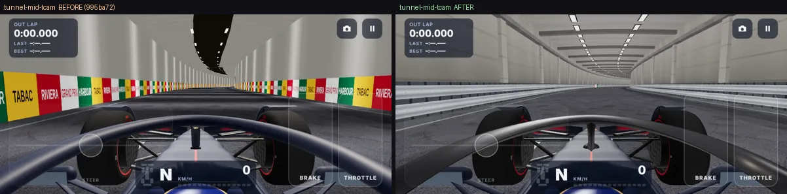

# Testing report

## What was tested, and how

All testing so far ran in a cloud container **without a physical phone and without a GPU**:
Chromium (Playwright) with mobile emulation and software WebGL (SwiftShader). There is no WebKit
engine in the container, so **iPhone Safari itself has not been exercised** — the iPhone runs
below use Chromium with the iPhone 15 Pro Max user agent, viewport (956 × 440 CSS px landscape,
the size of the Pro Max class including the iPhone 18 Pro Max) and touch emulation.

| Test | Environment | Result |
|---|---|---|
| Acceptance checks (`tools/gameplay-test.mjs`) | Emulated iPhone (956 × 440, touch, iOS UA), Chromium + SwiftShader | **43 / 43** pass |
| Acceptance checks | Emulated Android Chrome (Pixel 7, 915 × 412, touch) | **43 / 43** pass |
| Braking and traction (`tools/handling-test.mjs`) | Node.js physics | **9 / 9** pass (Standard assists), **8 / 8** (assists off) |
| Circuit inspection (`tools/inspect-circuit.mjs`) | Chromium, rendered scene, High and Low tiers | all 7 checks pass, self-test catches planted faults |
| Zero-steering straight line (`tools/straight-line-test.mjs`) | Node.js physics | all pass |
| Tunnel transitions (`tools/tunnel-test.mjs`) | Chromium, autopilot through the tunnel | smooth: max 0.011 exposure change per frame |
| Physics laps (`tools/sim-lap.mjs 2`) | Node.js | autopilot laps 80.988 s (out-lap start) and 79.683 s, 0 contacts, threshold braking without ABS |
| Smoke (`tools/smoke.mjs`) | Chromium | loads, drives, audio running, no errors |

Run them yourself:

```bash
node tools/serve.mjs 8080                    # local server
node tools/gameplay-test.mjs out iphone      # 43 acceptance checks (emulated)
node tools/gameplay-test.mjs out android
BASE_URL=https://loyoso34.github.io/Monaco-F1-Mobile/ node tools/gameplay-test.mjs out iphone   # against the live site
node tools/inspect-circuit.mjs               # circuit inspection, all graphics tiers (exit code 1 on failure)
node tools/straight-line-test.mjs            # zero steering / barrier brushes (exit code 1 on failure)
node tools/handling-test.mjs                 # braking (no ABS), trail braking, launches, corner exits
node tools/tunnel-test.mjs out               # tunnel lighting time series + frames
node tools/views.mjs out all                 # screenshots: inspection spots, road surface, mirrors, tunnel, halo
node tools/sim-lap.mjs 3                     # headless physics laps
node tools/track-report.mjs                  # circuit geometry checks
node tools/perf-probe.mjs                    # draw calls, CPU per frame, memory over laps
```

## Circuit inspection (`tools/inspect-circuit.mjs`)

Runs inside the page against the scene as rendered (world-space triangles), for each graphics
tier, using the track exclusion corridor (`js/corridor.js`):

1. **Raster** — every point 1 m inside the barriers of every section is marked as circuit
   (158,798 points, 0 holes).
2. **Track** — no barrier line of one section lies on the road or run-off of another section.
3. **Terrain** — the terrain mesh stays below the road, run-off and pavement surface everywhere
   (254,165 samples under the circuit).
4. **Objects** — no scenery triangle (buildings, landmarks, Fairmont, grandstands, garages,
   yachts, palms) enters the drivable volume: inside the barrier lines, from the road surface up
   to 5 m (≈ 3.5 million sample points every 0.5 m on the ~1,500 triangles near the circuit;
   cells that straddle a barrier are resolved exactly against the sections).
5. **Pavements** — no building stands on a pavement.
6. **Footprints** — no two building / landmark footprints overlap.
7. **Bases** — no building floats above the rendered terrain along its perimeter.

A **self-test** then plants a 4 m box on the racing line at Tabac and lifts one terrain vertex
through the road at Mirabeau; the inspection must report both (it does: 552 and 351 hits).

| | Previous release (995ba72) | Now |
|---|---|---|
| Terrain above the road / run-off / pavement | **16,430** samples, worst **36.6 m** above the road (Anthony Noghès 6,500 / worst 36.6 m, Rascasse 3,429 / 26.4 m, Tabac 2,575 / 10.4 m, Mirabeau Bas 1,703 / 4.6 m, Nouvelle Chicane 1,082 / 13.5 m, hairpin 1,016 / 2.5 m, Mirabeau, pool) | **0** |
| Scenery inside the drivable volume | **9,142** sample points (Nouvelle Chicane 3,999, Tabac 3,077, Massenet 943, Casino 918, Mirabeau 205) | **0** |
| Building points on pavements | **66,840** (every sector) | **0** |
| Overlapping footprints / floating bases | not tracked | **0 / 0** |

Before / after screenshots of the same camera positions (old build served from a worktree with
the same debug camera hook) show the causes: a building across the road at the Nouvelle Chicane,
half the view at Casino Square blocked by a building, grassy terrain rising over the barriers at
Tabac and Rascasse, and the black strip and wall-to-wall advertising in the tunnel.




## Zero steering / straight line (`tools/straight-line-test.mjs`, acceptance checks)

* **Root cause of the reported pull to the right:** light barrier brushes (a tyre or rim touching
  the wall, ~800–2,500 J) bent the suspension silently: 800 J on the front-right wheel left
  −0.40° of toe at HUD damage level 0, i.e. an invisible 6 m drift to the right within 6 s.
  Wheels now absorb brushes below 3.5 kJ elastically, and alignment only changes once the corner
  is visibly damaged on the HUD; a bent link stays bent the same way.
* **Touch input:** a 3.5 % dead zone around the thumb's touch-down point and an exact snap to 0
  when the target is 0, so a resting or trembling thumb steers nothing and released steering
  returns to exactly 0.
* **Results:** flat straight road, full throttle from rest for 8 s with zero steering from d = 0
  and ±1.6 m: heading change 0.00000°, lateral drift 0.0000 m, yaw rate 0. Brushes of 800–3,500 J
  on each wheel: toe 0.00°, camber 0.00°, no drift. A hard 9 kJ wheel strike bends the
  suspension visibly (HUD level 1, toe −0.70°). In the game (acceptance checks): released
  steering returns to exactly 0; tremor inside the dead zone gives 0; throttle only for 1.5 s
  gives 74 km/h with steering 0, heading change −0.0006° and yaw rate 0.0006°/s.
* **Start position:** the start / finish straight is a long right-hand curve (R ≈ 215–1000 m).
  The car now starts in the second grid slot on the right-hand side, 16 m before the line, where
  a car held perfectly straight runs ~120 m (4.2 s, ~200 km/h) before reaching the left-hand
  side — previously it started in the tightest part of the bend and met the left wall after 45 m.
  The car's own heading never changes without steering (0.002° after 84 m).

## Tunnel lighting transitions (`tools/tunnel-test.mjs`)

The autopilot drives Portier → tunnel → Nouvelle Chicane (no rendering, real-time simulation,
774 frames); then a rendered run captures frames at the entrance, inside and at the exit.

| Measure | Result |
|---|---|
| Exposure outside → inside | 1.00 → 1.31 (the tunnel stays a little darker than daylight) |
| Daylight on the car inside / sun inside | 0 / ≤ 3 % (the shell's shadow does the rest on High / Medium) |
| Entry: exposure 95 % adapted | 1.8 s after the portal (66 m in at ~150 km/h) |
| Exit: peak exposure / settled within 2 % | 1.24 at the portal / 0.75 s after it |
| Largest exposure change between frames | 0.011 (no visible steps) |

## Visual checks (`tools/views.mjs`, `tools/shots.mjs`, `tools/tour.mjs`)

Fixed and onboard cameras at the start straight, Sainte Dévote, Beau Rivage, Casino, Mirabeau,
the hairpin, Portier, the tunnel (entry, ceiling, walls, mid-tunnel from T-cam, cockpit and
chase, exit, both portals, the Fairmont from above and from the sea), the Nouvelle Chicane,
Tabac, the swimming pool and Rascasse; a 31-stop T-cam tour of the whole lap; the halo from
the T-cam, the cockpit, three-quarter, side, front, rear and close-ups of the pillar junction.

## Acceptance checks (`tools/gameplay-test.mjs`)

Cold launch (loading screen → menu with Drive and Settings) · the loading screen shows F1-27,
MAX VERSTAPPEN, ORACLE RED BULL RACING, MONACO GRAND PRIX and TIME TRIAL and fades out into the
menu · default camera is the T-cam · car spawns before the line with timing stopped · the
steering zone is exactly 20 % smaller than before (320 × 162 px vs 400 × 202 px on the
956 × 440 screen), bottom-left inside the safe area · touch targets kept away from the edges ·
steering starts anywhere in its zone and works while the throttle is held · **a right input
turns the steering wheel clockwise (as the driver sees it), the front wheels right and the car
right, at a 4.4 : 1 wheel-to-road-wheel ratio** · sliding the throttle thumb onto the brake
releases the throttle immediately · the brake pad is progressive (top 0.99, low 0.38) ·
released steering recentres · neutral
steering returns to exactly zero · a resting, trembling thumb gives exactly zero steering ·
throttle only: zero steering and the car holds its heading · page
gestures are prevented on the driving surface · timing starts on the first forward crossing ·
automatic upshifts (7 by Sainte Dévote) · HUD shows the gear · focus loss pauses the simulation,
freezes the timer and clears touches; Resume continues · a full lap is only recorded after all
checkpoints and a forward crossing · best lap saved locally · Fairmont hairpin taken in one
continuous turn at the full 23° lock · engine pulls through the tunnel (≈100 → 262 km/h, 2nd →
8th) · six individual downshifts into the Nouvelle Chicane · completed time displayed while the
next lap runs · cutting the Nouvelle Chicane shows "Lap invalid — corner cut." immediately ·
reversing over the line never starts a lap · Reset Car moves the car 8 m back to the centre line
facing the right way, keeps damage, invalidates the lap · glancing scrape on the pit wall at
~210 km/h: contact, slide along the wall, car continues · heavy frontal impact at 108 km/h breaks
the wing, crushes the nose and collapses the front suspension; the survival cell stops the car;
the run ends with Quick Restart offered · Quick Restart restores a repaired car at the start,
clears timing, keeps the personal best and the camera choice · personal best restored after a
fresh reload · portrait shows "Rotate your phone to play." · **both mirrors render the scene
behind the car into their render targets (non-uniform images) and the images change with the
surroundings (Sainte Dévote vs the Swimming Pool)** · no uncaught errors.

## Braking and traction (`tools/handling-test.mjs`)

The previous build locked the front tyres at the first instant of every stop, even at 290 km/h:
the *Standard* assist capped the brake demand at 1.06 × the available grip — above the 1.04
lock threshold — so the cap itself caused the slide, and trail braking spun the car (−32° /
−40°). That cap (an ABS-like aid) is gone. The tyres now carry wheel rotational dynamics: each
wheel's spin is integrated from drive, brake and tyre torques (semi-implicit, with the brake
holding a stopped wheel by static friction), so a lock-up happens only when the brake torque
really exceeds what the tyre can transmit. Line pressure builds over ~50 ms; the brake balance
is 57 % front at speed moving to 59.5 % at low speed; the rear brake-by-wire subtracts the
MGU-K harvest torque; load transfer comes from 15 ms-filtered accelerations; downforce scales
with speed², so the grip available for braking falls as the car slows — exactly when a real
driver releases pressure.

| Scenario (Standard assists) | Result |
|---|---|
| 290 → 0 km/h, full pedal | 4.65 g peak at 248 km/h, stops in 2.91 s / 94 m; fronts first lock at **189 km/h** (0.61 s in), car dead straight (0.0°) |
| 290 → 0 km/h, 70 % pedal | 3.47 g peak, first lock at **120 km/h**, straight |
| 200 → 0 km/h, 55 % pedal | 2.52 g peak, first lock at 75 km/h |
| 120 km/h, full pedal | fronts lock almost at once (0.10 s) — little downforce, no ABS; the car goes straight |
| Trail braking 180 km/h, full pedal + steering | heading +1.7°, max yaw rate 15.8°/s — no spin (was −32°) |
| Trail braking 120 km/h, 60 % + 0.4 steering | no rear lock, heading −3.8° — no spin (was −40°) |
| Standing start, full throttle | 43 km/h after 1 s, 144 km/h after 3 s, straight (traction control) |
| Corner exit 80 km/h, full throttle + steering | body slip 1.2°, 175 km/h after 2.5 s |
| Standing start, assists **off** | 2.1 s of wheelspin (slip up to 8.75), still straight, 125 km/h after 3 s |

In the game the brake pad maps the thumb height to pedal pressure (0.22 at the bottom edge to
1.0 at the top) and glows amber while a front tyre is locked, so the player can trail off the
pressure as the speed drops. The test driver (autopilot) threshold-brakes the same way a driver
would — it backs off when the front slip ratio passes the peak — and laps in 79.68 s with no
contacts.

## Steering wheel, hands and mirrors (visual checks)

* `tools/shots.mjs out wheelfront,wheelside,wheeltop,cockpit,tcam` with `steer=±0.3`:
  the wheel rotates anticlockwise for a left input and clockwise for a right input (as the
  driver sees it), the display and LEDs follow rpm and gear, both gloves stay on the grips and
  the arms stay attached through the full ±101° of wheel rotation.
* `tools/views.mjs out mirror-left-zoom,mirror-right-zoom,mirror-right-outside,mirror-right-front,mirrors-tcam,mirrors-cockpit,mirrors-chase-close`:
  each glass shows its own side of the car (rear tyre outboard, bodywork inboard), the barriers,
  grandstands and the road behind, upright and not left-right swapped; nothing crosses the
  line of sight to the glass. In the T-cam the mirrors sit at the lower corners as in TV
  footage; from the driver's eye they are ~55–65° off-axis, at the edges of the frame (as in
  helmet-camera footage).

## Road surface (visual checks)

`tools/views.mjs out road-ste-devote-brake,road-chicane-brake,road-chicane-top,road-hairpin-exit,road-casino-close,road-mirabeau-top,kerb-pool-close,kerb-rascasse-close,tunnel-mid-tcam`:
aggregate texture visible close up without shimmering further away (anisotropic filtering,
mipmaps), no visible 3 m repeat, soft rubbered racing line, braking streaks and lock-up marks
before the chicane / Sainte Dévote / hairpin, traction marks after the hairpin, saw-cut
patches, seams and covers, saturated painted kerbs, unchanged tunnel brightness. Overlays sit
6 mm above the road with polygon offset — no z-fighting at any distance checked.

## Performance (measured in emulation)

Same container, same software renderer, back-to-back runs of the previous release (04528c3)
and this build (`tools/perf-probe.mjs`, T-cam, High tier, 10 points round the lap):

| Measure | Previous release | Now |
|---|---|---|
| Draw calls per frame, main + shadow pass | 64–154 | 106–213 |
| Mirror pass (one glass per frame, only while a mirror is on screen) | — | ~75 calls at the start straight in the T-cam; 0 in the cockpit view (glasses off-screen) |
| Triangles per frame | 73 k – 158 k | 95 k – 201 k (car 44 k → 66 k: cockpit, wheel, gloves, ducts, mirrors; road rubber profile and overlays) |
| Frame time under software GL (CPU rasteriser — relative only) | 211–276 ms | 305–411 ms |
| Simulation + game logic per frame | 0.25 ms avg | 0.42 ms avg, ~0.9 ms peak (wheel-spin dynamics, cockpit display / LEDs, arm IK) |
| Memory over 3 laps + crash + restart + 1 lap | flat | flat (JS heap 81 → 81 MB, debris cleared) |

What keeps the cost down:

* **Draw calls:** the steering wheel's static parts and each glove are merged per material
  (car meshes 182 → 133, car draw calls in the main pass 118 → 78 in the cockpit view); the
  car body is merged per material inside each detachable part as before; road overlays are one
  mesh per ~600 m; kerbs / lines one mesh per 150 m chunk.
* **Mirrors:** 256 × 88 half-float targets (192 × 66 Medium, 128 × 44 Low), the two glasses
  alternate frames (each refreshes at half the frame rate; every fourth frame on Low), a glass that is off-screen or seen edge-on is skipped, and the mirror pass never
  re-renders the shadow map.
* **Textures:** asphalt 1,024² (map, normal, roughness) on High / Medium, 512² on Low; one
  1,024² atlas for every road mark; decals sized to their real area (2,200–4,000 px/m); the
  wheel display (512 × 288) is redrawn at ≤ 15 Hz and only when a shown value changes.
* **Adaptive quality** (Graphics = Auto) scales the render resolution down in steps when the
  60th-percentile frame time exceeds 18.2 ms, then drops to the Medium / Low tier (smaller
  shadow map and mirror targets, then no shadows). Choosing Graphics = Low before driving also
  builds the circuit with 512² asphalt without normal / roughness maps and without catch fences. The DOM HUD
  is unaffected by render scaling and stays sharp.

The software renderer here shades every pixel on the CPU, so the PBR road (normal + roughness
maps over half the screen) and the extra geometry weigh far more than on a phone GPU. On the
A-series GPU the budget that matters is CPU-side draw-call submission (~280 per frame in the
T-cam, all passes) and fill rate at 2× resolution — both well within an iPhone Pro's range, but
**not measured on the device** (see below).

## Still needs a physical-phone test

* **Sustained 60 FPS on the iPhone 18 Pro Max** — not measurable here (software GPU). Check with
  Settings → Show FPS while driving several laps round the harbour, through the tunnel (the
  highest triangle count), in the T-cam (mirror passes) and during a crash.
* **Half-float render targets on iOS Safari** for the mirrors (WebGL 2 with
  `EXT_color_buffer_float` / `_half_float`); without them the mirrors fall back to 8-bit sRGB
  targets automatically.
* **iPhone Safari specifics** — WebKit audio unlock on the first tap, `navigator.audioSession`,
  the AudioWorklet engine, home-indicator spacing, Add-to-Home-Screen full-screen mode.
* **Audio on phone speakers and headphones** — the mix was verified by spectral analysis and
  level measurement, not by ear. Listen for the engine character, shift cracks, downshift blips,
  tyre scrub under braking and the tunnel transition.
* **Thermal behaviour** over long sessions and real touch latency.
