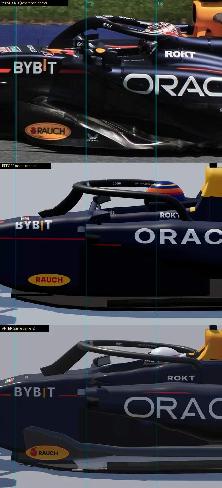

# Testing report

## 2026 upgrade: what was tested, and how

Same environment as below: a cloud container **without a phone and without a GPU** - Chromium
(Playwright) with iPhone emulation (iPhone 15 Pro Max user agent, 956 × 440 landscape, touch)
and software WebGL (SwiftShader). **No iPhone, no Safari / WebKit, no GPU**: frame rates here
say nothing about the phone (see *Still needs a physical-phone test*).

| Test | Result |
|---|---|
| Acceptance checks (`tools/gameplay-test.mjs out iphone`) | **43 / 43** pass (steering direction, wheel ratio, pedals, timing, damage, mirrors, no page errors) |
| Circuit inspection (`tools/inspect-circuit.mjs`) | **all checks pass on High, Medium and Low**: 0 scenery points in the drivable volume (new balconies, awnings, retaining walls included), 0 buildings on pavements, 0 overlapping footprints of 608, 0 floating bases of 552, terrain under the circuit everywhere; self-test still catches planted faults |
| Braking / traction (`tools/handling-test.mjs`) | **9 / 9** (Standard), **8 / 8** (assists off) |
| Zero steering / straight line (`tools/straight-line-test.mjs`) | all pass: heading change 0.00000°, drift 0.0000 m |
| Lap check at racing speed (`tools/lap-check.mjs`) | **12 / 12**: both mirrors live and varied at 62-271 km/h, in sun, shade and the tunnel |
| Physics laps (`tools/sim-lap.mjs 2`) | 80.929 s (out-lap) and 79.687 s, 0 contacts (79.683 s before) |
| Halo markings shimmer (`tools/decal-shimmer-test.mjs`) | **4 / 4**: residual under sub-pixel motion at or below the 16x supersampled ideal (sun / shade / tunnel, cockpit and T-cam) |
| Physics audit (`tools/physics-audit.mjs`) | before / after below |

### Before / after (same cameras, same positions)

* Side profile matched to the 2024 reference photo (camera fitted to the photo, not to the
  model): [img/ba-reference-side.webp](img/ba-reference-side.webp)
* Front and rear three-quarter, cockpit and T-cam model views: [img/ba-car.webp](img/ba-car.webp)
* Eight Monaco corners from the T-cam (start straight, Sainte Dévote, Casino Square, the
  hairpin, the tunnel exit, Tabac, Swimming Pool, La Rascasse): [img/ba-monaco.webp](img/ba-monaco.webp)



### Physics audit: why the car slid, and the result

`tools/physics-audit.mjs` drives fixed manoeuvres on a flat pad and on the circuit. Steady
state, the car was (and is) understeer-biased: the rear tyres never pass ~58 % of their peak
slip angle. The sliding came from the input side and from missing physics:

| Symptom | Cause found | Before | After |
|---|---|---|---|
| Fronts scrub / the car slides wide | the speed-dependent steering range put ~35 % of the thumb travel beyond the front tyres' peak at every speed | fronts past peak from 60-70 % input (100-250 km/h) | grip-based range: fronts pass the peak only in the last ~10 % of travel, at every speed |
| Stops end in a front slide | a full-pedal thumb press locked the fronts for most of a stop | 200 -> 80 km/h: fronts locked 1.04 s of 1.25 s | 0.10 s (Standard brake-lock aid; Off is unchanged) |
| Hard to catch a slide | tyre force fell to 76 % of peak when fully sliding | 76 % | 83 % (progressive breakaway, same peak grip) |
| Power exits on/off | the throttle pad was full over its top 70 % | on / off | top third full, progressive below (25 % at the bottom edge) |
| Kerbs and bumps not felt | no vertical dynamics: a kerb only changed the friction by 6 % | load swing 0 | unsprung corners: kerb strike swings the tyre load -3.9 / +2.5 kN |
| Handling varied with frame rate | per-frame step inputs through a frame-rate-dependent filter | continuous thumb motion, 30 vs 240 fps: 0.19 m / 0.05° after 4 s | 0.08 m / 0.01° (exact exponential filter, inputs ramped across each frame's sub-steps) |

Unchanged and still good: Swimming-Pool slaloms at 140-200 km/h (body slip ≤ 3°, settles in
< 0.1 s), lift-off and trail braking mid-corner (body slip change ≤ 2.6°, no spin), full lock
at hairpin speeds (path radius 6.0 m at 45 km/h against the hairpin's 9.8 m centre line),
0-100 km/h 2.2 s with zero drift. With assists off, flooring the throttle in 1st / 2nd while
steering still spins the car - as it would.

### Performance (measured here, all render passes per frame)

Totals over every pass (main view, sun shadow, mirror, car reflection cube, PMREM filter), T-cam,
High tier, at ten points round the lap:

| | Before | After |
|---|---|---|
| Draw calls per frame | 253-369 (avg 310) | 285-404 (avg 345) |
| Triangles per frame | 314-426 k (avg 368 k) | 442-600 k (avg 524 k) |
| Building-shade bake at load | - | 0.26 s (once; first version took 31 s - the exact terrain function per ray step - fixed by sampling the drawn terrain grid) |

Cost control added for the new work: building detail (balconies, awnings, cornices,
parapets, plant) is a separate mesh per 150 m tile on its own render layer, drawn only in the
main view and only within 280 m; the mirrors (to 200 m) and the reflection cube (to 240 m,
one face per frame, building walls and roofs only) skip it; one facade material for the whole
city; the building shade is baked once at load. The adaptive quality still lowers the render
scale, then the tier (Medium: 64 px reflection cube, smaller mirrors and shadow map; Low:
static sky reflections).

## Earlier work: what was tested, and how

All testing so far ran in a cloud container **without a physical phone and without a GPU**:
Chromium (Playwright) with mobile emulation and software WebGL (SwiftShader). There is no WebKit
engine in the container, so **iPhone Safari itself has not been exercised** — the iPhone runs
below use Chromium with the iPhone 15 Pro Max user agent, viewport (956 × 440 CSS px landscape,
the size of the Pro Max class including the iPhone 18 Pro Max) and touch emulation.

| Test | Environment | Result |
|---|---|---|
| Acceptance checks (`tools/gameplay-test.mjs`) | Emulated iPhone (956 × 440, touch, iOS UA), Chromium + SwiftShader | **43 / 43** pass |
| Acceptance checks | Emulated Android Chrome (Pixel 7, 915 × 412, touch) | **43 / 43** pass |
| Braking and traction (`tools/handling-test.mjs`) | Node.js physics | **9 / 9** pass (Standard assists), **8 / 8** (assists off) |
| Circuit inspection (`tools/inspect-circuit.mjs`) | Chromium, rendered scene, High and Low tiers | all 7 checks pass, self-test catches planted faults |
| Zero-steering straight line (`tools/straight-line-test.mjs`) | Node.js physics | all pass |
| Tunnel transitions (`tools/tunnel-test.mjs`) | Chromium, autopilot through the tunnel | smooth: max 0.011 exposure change per frame |
| Physics laps (`tools/sim-lap.mjs 2`) | Node.js | autopilot laps 80.988 s (out-lap start) and 79.683 s, 0 contacts, threshold braking without ABS |
| Smoke (`tools/smoke.mjs`) | Chromium | loads, drives, audio running, no errors |
| Halo markings shimmer (`tools/decal-shimmer-test.mjs`) | Chromium, rendered game, cockpit + T-cam, sun / shade / tunnel | **4 / 4** pass: within the supersampled ideal |
| Lap check (`tools/lap-check.mjs`) | Chromium, 12 points round the lap at racing speed | **12 / 12**: both mirrors show a live, varied scene from the driver's eye |
| Materials in every light (`tools/material-check.mjs`) | Chromium, sun-lit side, shaded side, tunnel | all paint / carbon / rubber / halo pairs distinguishable (Delta-E 3.6–29) |
| **Frame rate on an iPhone** | **not measured: no iPhone or GPU was available to this session** | run `?bench=1` on the phone (see *Performance*) |

Run them yourself:

```bash
node tools/serve.mjs 8080                    # local server
node tools/gameplay-test.mjs out iphone      # 43 acceptance checks (emulated)
node tools/gameplay-test.mjs out android
BASE_URL=https://loyoso34.github.io/Monaco-F1-Mobile/ node tools/gameplay-test.mjs out iphone   # against the live site
node tools/inspect-circuit.mjs               # circuit inspection, all graphics tiers (exit code 1 on failure)
node tools/straight-line-test.mjs            # zero steering / barrier brushes (exit code 1 on failure)
node tools/handling-test.mjs                 # braking (no ABS), trail braking, launches, corner exits
node tools/tunnel-test.mjs out               # tunnel lighting time series + frames
node tools/views.mjs out all                 # screenshots: inspection spots, road surface, mirrors, tunnel, halo
node tools/sim-lap.mjs 3                     # headless physics laps
node tools/track-report.mjs                  # circuit geometry checks
node tools/perf-probe.mjs                    # draw calls, CPU per frame, memory over laps
```

## Circuit inspection (`tools/inspect-circuit.mjs`)

Runs inside the page against the scene as rendered (world-space triangles), for each graphics
tier, using the track exclusion corridor (`js/corridor.js`):

1. **Raster** — every point 1 m inside the barriers of every section is marked as circuit
   (158,798 points, 0 holes).
2. **Track** — no barrier line of one section lies on the road or run-off of another section.
3. **Terrain** — the terrain mesh stays below the road, run-off and pavement surface everywhere
   (254,165 samples under the circuit).
4. **Objects** — no scenery triangle (buildings, landmarks, Fairmont, grandstands, garages,
   yachts, palms) enters the drivable volume: inside the barrier lines, from the road surface up
   to 5 m (≈ 3.5 million sample points every 0.5 m on the ~1,500 triangles near the circuit;
   cells that straddle a barrier are resolved exactly against the sections).
5. **Pavements** — no building stands on a pavement.
6. **Footprints** — no two building / landmark footprints overlap.
7. **Bases** — no building floats above the rendered terrain along its perimeter.

A **self-test** then plants a 4 m box on the racing line at Tabac and lifts one terrain vertex
through the road at Mirabeau; the inspection must report both (it does: 552 and 351 hits).

| | Previous release (995ba72) | Now |
|---|---|---|
| Terrain above the road / run-off / pavement | **16,430** samples, worst **36.6 m** above the road (Anthony Noghès 6,500 / worst 36.6 m, Rascasse 3,429 / 26.4 m, Tabac 2,575 / 10.4 m, Mirabeau Bas 1,703 / 4.6 m, Nouvelle Chicane 1,082 / 13.5 m, hairpin 1,016 / 2.5 m, Mirabeau, pool) | **0** |
| Scenery inside the drivable volume | **9,142** sample points (Nouvelle Chicane 3,999, Tabac 3,077, Massenet 943, Casino 918, Mirabeau 205) | **0** |
| Building points on pavements | **66,840** (every sector) | **0** |
| Overlapping footprints / floating bases | not tracked | **0 / 0** |

Before / after screenshots of the same camera positions (old build served from a worktree with
the same debug camera hook) show the causes: a building across the road at the Nouvelle Chicane,
half the view at Casino Square blocked by a building, grassy terrain rising over the barriers at
Tabac and Rascasse, and the black strip and wall-to-wall advertising in the tunnel.


## Zero steering / straight line (`tools/straight-line-test.mjs`, acceptance checks)

* **Root cause of the reported pull to the right:** light barrier brushes (a tyre or rim touching
  the wall, ~800–2,500 J) bent the suspension silently: 800 J on the front-right wheel left
  −0.40° of toe at HUD damage level 0, i.e. an invisible 6 m drift to the right within 6 s.
  Wheels now absorb brushes below 3.5 kJ elastically, and alignment only changes once the corner
  is visibly damaged on the HUD; a bent link stays bent the same way.
* **Touch input:** a 3.5 % dead zone around the thumb's touch-down point and an exact snap to 0
  when the target is 0, so a resting or trembling thumb steers nothing and released steering
  returns to exactly 0.
* **Results:** flat straight road, full throttle from rest for 8 s with zero steering from d = 0
  and ±1.6 m: heading change 0.00000°, lateral drift 0.0000 m, yaw rate 0. Brushes of 800–3,500 J
  on each wheel: toe 0.00°, camber 0.00°, no drift. A hard 9 kJ wheel strike bends the
  suspension visibly (HUD level 1, toe −0.70°). In the game (acceptance checks): released
  steering returns to exactly 0; tremor inside the dead zone gives 0; throttle only for 1.5 s
  gives 74 km/h with steering 0, heading change −0.0006° and yaw rate 0.0006°/s.
* **Start position:** the start / finish straight is a long right-hand curve (R ≈ 215–1000 m).
  The car now starts in the second grid slot on the right-hand side, 16 m before the line, where
  a car held perfectly straight runs ~120 m (4.2 s, ~200 km/h) before reaching the left-hand
  side — previously it started in the tightest part of the bend and met the left wall after 45 m.
  The car's own heading never changes without steering (0.002° after 84 m).

## Tunnel lighting transitions (`tools/tunnel-test.mjs`)

The autopilot drives Portier → tunnel → Nouvelle Chicane (no rendering, real-time simulation,
774 frames); then a rendered run captures frames at the entrance, inside and at the exit.

| Measure | Result |
|---|---|
| Exposure outside → inside | 1.00 → 1.31 (the tunnel stays a little darker than daylight) |
| Daylight on the car inside / sun inside | 0 / ≤ 3 % (the shell's shadow does the rest on High / Medium) |
| Entry: exposure 95 % adapted | 1.8 s after the portal (66 m in at ~150 km/h) |
| Exit: peak exposure / settled within 2 % | 1.24 at the portal / 0.75 s after it |
| Largest exposure change between frames | 0.011 (no visible steps) |

## Visual checks (`tools/views.mjs`, `tools/shots.mjs`, `tools/tour.mjs`)

Fixed and onboard cameras at the start straight, Sainte Dévote, Beau Rivage, Casino, Mirabeau,
the hairpin, Portier, the tunnel (entry, ceiling, walls, mid-tunnel from T-cam, cockpit and
chase, exit, both portals, the Fairmont from above and from the sea), the Nouvelle Chicane,
Tabac, the swimming pool and Rascasse; a 31-stop T-cam tour of the whole lap; the halo from
the T-cam, the cockpit, three-quarter, side, front, rear and close-ups of the pillar junction.

## Acceptance checks (`tools/gameplay-test.mjs`)

Cold launch (loading screen → menu with Drive and Settings) · the loading screen shows F1-27,
MAX VERSTAPPEN, ORACLE RED BULL RACING, MONACO GRAND PRIX and TIME TRIAL and fades out into the
menu · default camera is the T-cam · car spawns before the line with timing stopped · the
steering zone is exactly 20 % smaller than before (320 × 162 px vs 400 × 202 px on the
956 × 440 screen), bottom-left inside the safe area · touch targets kept away from the edges ·
steering starts anywhere in its zone and works while the throttle is held · **a right input
turns the steering wheel clockwise (as the driver sees it), the front wheels right and the car
right, at a 4.4 : 1 wheel-to-road-wheel ratio** · sliding the throttle thumb onto the brake
releases the throttle immediately · the brake pad is progressive (top 0.99, low 0.38) ·
released steering recentres · neutral
steering returns to exactly zero · a resting, trembling thumb gives exactly zero steering ·
throttle only: zero steering and the car holds its heading · page
gestures are prevented on the driving surface · timing starts on the first forward crossing ·
automatic upshifts (7 by Sainte Dévote) · HUD shows the gear · focus loss pauses the simulation,
freezes the timer and clears touches; Resume continues · a full lap is only recorded after all
checkpoints and a forward crossing · best lap saved locally · Fairmont hairpin taken in one
continuous turn at the full 23° lock · engine pulls through the tunnel (≈100 → 262 km/h, 2nd →
8th) · six individual downshifts into the Nouvelle Chicane · completed time displayed while the
next lap runs · cutting the Nouvelle Chicane shows "Lap invalid — corner cut." immediately ·
reversing over the line never starts a lap · Reset Car moves the car 8 m back to the centre line
facing the right way, keeps damage, invalidates the lap · glancing scrape on the pit wall at
~210 km/h: contact, slide along the wall, car continues · heavy frontal impact at 108 km/h breaks
the wing, crushes the nose and collapses the front suspension; the survival cell stops the car;
the run ends with Quick Restart offered · Quick Restart restores a repaired car at the start,
clears timing, keeps the personal best and the camera choice · personal best restored after a
fresh reload · portrait shows "Rotate your phone to play." · **both mirrors render the scene
behind the car into their render targets (non-uniform images) and the images change with the
surroundings (Sainte Dévote vs the Swimming Pool)** · no uncaught errors.

## Braking and traction (`tools/handling-test.mjs`)

The previous build locked the front tyres at the first instant of every stop, even at 290 km/h:
the *Standard* assist capped the brake demand at 1.06 × the available grip — above the 1.04
lock threshold — so the cap itself caused the slide, and trail braking spun the car (−32° /
−40°). That cap (an ABS-like aid) is gone. The tyres now carry wheel rotational dynamics: each
wheel's spin is integrated from drive, brake and tyre torques (semi-implicit, with the brake
holding a stopped wheel by static friction), so a lock-up happens only when the brake torque
really exceeds what the tyre can transmit. Line pressure builds over ~50 ms; the brake balance
is 57 % front at speed moving to 59.5 % at low speed; the rear brake-by-wire subtracts the
MGU-K harvest torque; load transfer comes from 15 ms-filtered accelerations; downforce scales
with speed², so the grip available for braking falls as the car slows — exactly when a real
driver releases pressure.

| Scenario (Standard assists) | Result |
|---|---|
| 290 → 0 km/h, full pedal | 4.65 g peak at 248 km/h, stops in 2.91 s / 94 m; fronts first lock at **189 km/h** (0.61 s in), car dead straight (0.0°) |
| 290 → 0 km/h, 70 % pedal | 3.47 g peak, first lock at **120 km/h**, straight |
| 200 → 0 km/h, 55 % pedal | 2.52 g peak, first lock at 75 km/h |
| 120 km/h, full pedal | fronts lock almost at once (0.10 s) — little downforce, no ABS; the car goes straight |
| Trail braking 180 km/h, full pedal + steering | heading +1.7°, max yaw rate 15.8°/s — no spin (was −32°) |
| Trail braking 120 km/h, 60 % + 0.4 steering | no rear lock, heading −3.8° — no spin (was −40°) |
| Standing start, full throttle | 43 km/h after 1 s, 144 km/h after 3 s, straight (traction control) |
| Corner exit 80 km/h, full throttle + steering | body slip 1.2°, 175 km/h after 2.5 s |
| Standing start, assists **off** | 2.1 s of wheelspin (slip up to 8.75), still straight, 125 km/h after 3 s |

In the game the brake pad maps the thumb height to pedal pressure (0.22 at the bottom edge to
1.0 at the top) and glows amber while a front tyre is locked, so the player can trail off the
pressure as the speed drops. The test driver (autopilot) threshold-brakes the same way a driver
would — it backs off when the front slip ratio passes the peak — and laps in 79.68 s with no
contacts.

## Steering wheel, hands and mirrors (visual checks)

* `tools/shots.mjs out wheelfront,wheelside,wheeltop,cockpit,tcam` with `steer=±0.3`:
  the wheel rotates anticlockwise for a left input and clockwise for a right input (as the
  driver sees it), the display and LEDs follow rpm and gear, both gloves stay on the grips and
  the arms stay attached through the full ±101° of wheel rotation.
* `tools/views.mjs out mirror-left-zoom,mirror-right-zoom,mirror-right-outside,mirror-right-front,mirrors-tcam,mirrors-cockpit,mirrors-chase-close`:
  each glass shows its own side of the car (rear tyre outboard, bodywork inboard), the barriers,
  grandstands and the road behind, upright and not left-right swapped; nothing crosses the
  line of sight to the glass. In the T-cam the mirrors sit at the lower corners as in TV
  footage; from the driver's eye they are ~55–65° off-axis, at the edges of the frame (as in
  helmet-camera footage).

## Road surface (visual checks)

`tools/views.mjs out road-ste-devote-brake,road-chicane-brake,road-chicane-top,road-hairpin-exit,road-casino-close,road-mirabeau-top,kerb-pool-close,kerb-rascasse-close,tunnel-mid-tcam`:
aggregate texture visible close up without shimmering further away (anisotropic filtering,
mipmaps), no visible 3 m repeat, soft rubbered racing line, braking streaks and lock-up marks
before the chicane / Sainte Dévote / hairpin, traction marks after the hairpin, saw-cut
patches, seams and covers, saturated painted kerbs, unchanged tunnel brightness. Overlays sit
6 mm above the road with polygon offset — no z-fighting at any distance checked.

## Halo markings: sharpness and shimmer (`tools/decal-shimmer-test.mjs`)

Shimmer is texture aliasing that shows when the camera moves by fractions of a pixel (vibration,
steering, bumps). In the rendered game the test renders each spot 16 times with sub-pixel
projection offsets (-0.5..0.5 px) and compares every frame with the unshifted frame resampled
at the same offset - what a correctly filtered image does under that motion. The mean residual
over the ~3,200-4,150 pixels the halo markings cover is the shimmer; references: the same
markings rendered 16x supersampled (practically alias-free) and without mipmaps (what shimmering
decals look like).

| Spot | Game | Supersampled ideal | Unfiltered |
|---|---|---|---|
| Sun, cockpit | 0.0363 | 0.0400 | 0.0749 |
| Sun, T-cam | 0.0661 | 0.0769 | 0.1484 |
| Shade, cockpit | 0.0416 | 0.0461 | 0.0862 |
| Tunnel, cockpit | 0.0352 | 0.0385 | 0.0726 |

The game is at (in fact marginally below) the supersampled ideal - mipmaps + 16x anisotropic
filtering - and half of the unfiltered value: the markings move smoothly instead of crawling.
They are also sharp: the marking atlas has 4,600 texels per metre against ~620 screen pixels
per metre at the markings' median distance from the driver's eye (0.46 m, helmet-camera field
of view; ~1,250 at the iPhone's 2x render scale), so they are never magnified.

## Lap check (`tools/lap-check.mjs`)

At 12 points round the lap, at racing speed (69-260 km/h), the T-cam, chase and cockpit views
are captured and a contact sheet is written. Both mirrors, read from the driver's eye, show a
live and varied image (luminance standard deviation 0.07-0.20, 11-16 distinct levels) that
changes from point to point, in the sun and in the tunnel: 12 / 12.

## Materials in sun, shade and the tunnel (`tools/material-check.mjs`)

The street scenery casts no shadows in this build (only the car and the tunnel do), so "in
shadow" means the car's faces turned away from the sun - lit by the sky and the street only -
and the tunnel. ID renders split each frame into navy paint (navy areas of the livery only),
exposed carbon, tyre rubber and the halo; the mean colours are compared as CIE Lab Delta-E
(2.3 = just noticeable):

| Light | paint / carbon | paint / rubber | paint / halo | carbon / rubber | carbon / halo | rubber / halo |
|---|---|---|---|---|---|---|
| Sun-lit side | 11.8 | 29.3 | 15.3 | 24.7 | 3.6 | 23.1 |
| Shaded side | 11.1 | 14.5 | 10.3 | 14.5 | 9.0 | 9.4 |
| Tunnel | 10.9 | 19.6 | 8.0 | 19.3 | 8.5 | 17.3 |

(The first tunnel measurement failed - paint / halo 2.7, carbon / halo 1.8 - because the tunnel
lit the car far less than its bright walls; the tunnel's reflection environment and lamp fill
were corrected to light painted walls and ceiling with lamp rows.)

## Performance

**Frame rate on an iPhone was not measured.** This session ran in a cloud container with no GPU
and no phone or computer attached, so the iPhone 18 Pro Max / Safari target could not be
verified. The only renderer here is SwiftShader (a CPU rasteriser): the built-in benchmark runs
at 0.6 FPS at 1912 x 880 there, which says nothing about a phone GPU. To measure on the device,
open `https://loyoso34.github.io/Monaco-F1-Mobile/?bench=1&cam=cockpit` (and `cam=tcam`) in
Safari: the result panel reports the device, the GPU, the render size, average FPS, 1 % low and
frame-time percentiles.

What was measured here (same container, `tools/perf-probe.mjs` and a per-pass breakdown at the
start straight, High tier):

| Per frame | Previous release (4bf8607) | Now |
|---|---|---|
| Draw calls, T-cam (main + shadow + one mirror) | 296 | 301 (main 167, shadow 57, mirror 78) |
| Draw calls, cockpit | 229 (mirrors off-screen) | 364 (main 219, shadow 60, mirror 85): the wider helmet-camera view now shows both mirrors, so a mirror renders every frame, and more of the street is in view |
| Car | 133 meshes, 66 k triangles | 124 meshes, 84 k triangles (new halo, tyre profile; decals now one atlas, merged per part) |
| Triangles, T-cam | 302 k | 347 k |
| Simulation + game logic | 0.42 ms avg | unchanged (no physics changes) |
| Memory over 3 laps + crash + restart | flat | flat |

Cost control: one decal atlas merged per car part (car transparent meshes 34 -> 13), the
driver / wheel / arms skipped by the mirror cameras (render layer 1), the mirror far plane at
320 m, the two glasses on alternate frames, no shadow-map update in the mirror pass, the wheel
display redrawn only on change, and adaptive resolution (Graphics = Auto) that lowers the render
scale and then the tier (smaller mirrors and shadow map) when the 60th-percentile frame time
exceeds 18.2 ms. The environment maps are half-float (linear filtering is core in WebGL 2 for
half float; 32-bit float filtering is not available on every phone), and the mirror targets
fall back to 8-bit sRGB where the GPU cannot render to half float.

## Still needs a physical-phone test

* **2026 upgrade on a real iPhone (Safari / Home Screen app)**: the frame rate with the
  architectural city and the live car reflections (`?bench=1&cam=tcam` and `&cam=cockpit`,
  twice); the shader hooks (custom tone mapping, car-only sunlight, hemisphere share) compile
  under WebKit's ANGLE / Metal; the half-float reflection cube; the load time added by the
  shade bake; heat over a long session. If the 1 % low falls under ~55 FPS, Graphics = Medium
  halves the reflection cube and the shadow map.
* **Sustained 60 FPS on the iPhone 18 Pro Max** — not measured (no device, no GPU here). Run
  `?bench=1&cam=cockpit` and `?bench=1&cam=tcam` in Safari (twice: the first run warms the
  shader cache), and check Settings → Show FPS through the tunnel and during a crash. If the
  1 % low falls under ~55 FPS, Graphics = Medium halves the shadow map and shrinks the mirrors.
* **Half-float render targets on iOS Safari** for the mirrors (WebGL 2 with
  `EXT_color_buffer_float` / `_half_float`); without them the mirrors fall back to 8-bit sRGB
  targets automatically.
* **iPhone Safari specifics** — WebKit audio unlock on the first tap, `navigator.audioSession`,
  the AudioWorklet engine, home-indicator spacing, Add-to-Home-Screen full-screen mode.
* **Audio on phone speakers and headphones** — the mix was verified by spectral analysis and
  level measurement, not by ear. Listen for the engine character, shift cracks, downshift blips,
  tyre scrub under braking and the tunnel transition.
* **Thermal behaviour** over long sessions and real touch latency.
