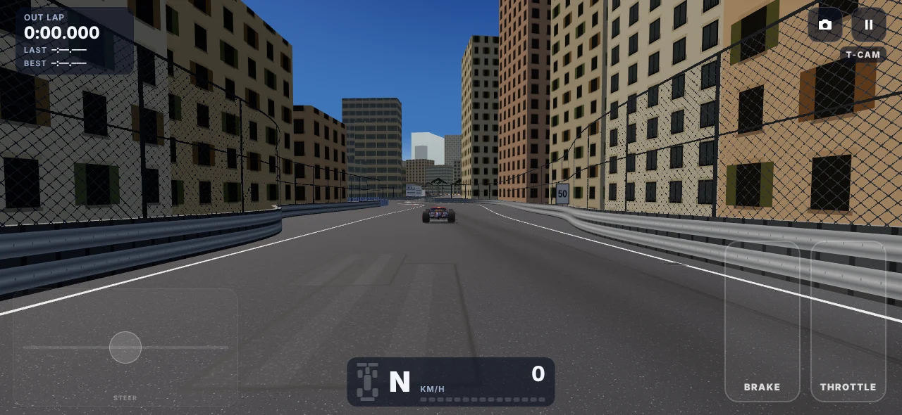

# Circuit de Monaco — data and processing

## Centre line

* **Source:** `tools/mc-1929.geojson` from [bacinger/f1-circuits](https://github.com/bacinger/f1-circuits)
  (MIT licence, see `tools/f1-circuits-LICENSE.md`): a 159-point geo-referenced trace of the
  current layout, 3,328 m long.
* **Processing** (`js/track-core.js`, runs at load in ~80 ms):
  1. project WGS-84 to local metres (x east, z south) around 43.7375 N / 7.4235 E;
  2. resample every ~3 m and remove trace jitter with Taubin smoothing (no shrinkage);
  3. round the hand-traced corner vertices with local Laplacian passes where the real corner is
     larger than the trace (Tabac, Pool, Ste Dévote, Portier, Casino…);
  4. variable-width heading smoothing (30 m in the tunnel, 2.5 m at the hairpin) and
     re-integration with the closure error distributed around the lap; the result stays within
     9 m of the trace;
  5. scale to the official **3,337 m** (+0.27 %).
* **Verification against the scaled map** (`node tools/track-report.mjs`, `tools/track-proximity.mjs`):

| Corner | Lap distance | Min. centre-line radius | Width | Elevation |
|---|---:|---:|---:|---:|
| T1 Sainte Dévote | 386 m | 26 m | 11.9 m | 8.9 m |
| T3 Massenet | 946 m | 52 m | 11.0 m | 43.2 m |
| T4 Casino Square | 1,065 m | 43 m | 11.2 m | 45.5 m |
| T5 Mirabeau Haute | 1,318 m | 16 m | 11.0 m | 34.5 m |
| T6 Fairmont Hairpin | 1,449 m | 9.8 m | 11.8 m | 27.3 m |
| T8 Portier | 1,617 m | 18 m | 10.6 m | 12.8 m |
| T9 Tunnel | 1,653–2,108 m | 275 m | 10.4 m | ~11 m |
| T10–11 Nouvelle Chicane | 2,291 m | 19 m | 11.0 m | 3.2 m |
| T12 Tabac | 2,560 m | 86 m | 10.6 m | 2.8 m |
| T13–14 Swimming Pool | 2,724 m | 54 m | 11.0 m | 2.6 m |
| T15–16 Swimming Pool exit | 2,892 m | 24 m | 11.0 m | 2.5 m |
| T17–18 La Rascasse | 3,101 m | 11 m | 10.6 m | 3.3 m |
| T19 Anthony Noghès | 3,194 m | 20 m | 11.4 m | 4.1 m |

* **Elevation:** keyed by lap distance, 2.5 m (harbour) to 45.5 m (Casino Square): 43 m range
  (published elevation change: 42 m). The climb from Sainte Dévote peaks at 8.8 % on Beau
  Rivage; the drop from the hairpin to Portier reaches 11.5 %; the tunnel exit falls ~4 % into the
  braking zone of the Nouvelle Chicane.
* **Neighbouring sections:** the hairpin entry and exit run 15.8 m apart with 4 m between their
  barriers; the projection used by physics and timing is hinted by the car's own lap distance so
  close sections never get confused.
* **Barriers & run-off:** barriers sit 0.55–1.1 m beyond the kerbs except the Ste Dévote and
  Mirabeau escape roads, the Nouvelle Chicane escape road and the pool and Rascasse run-offs.
  Armco with catch fencing, advertising walls, Tecpro at the escape roads, a concrete pit wall
  and, in the tunnel, armco in front of concrete walls (see *The tunnel* below).
* **Timing:** 12 ordered checkpoints, three cut zones (Nouvelle Chicane, both Swimming Pool
  chicanes): the lap is invalid when the car's centre goes more than 0.55 m beyond the kerb.

## Track exclusion corridor and scenery placement

Nothing the player can see may stand on the circuit. `js/corridor.js` rasterises every
cross-section of the lap into 1.25 m cells up to 36 m beyond the barriers and records, per cell:
the clearance beyond the nearest barrier of **any** section, the clearance beyond the pavement
edge, and the lowest road / run-off / pavement surface height. Pavement widths are 4.5 m (13 m on
the pit side of the start straight), clipped to half the free gap where two sections run close
together (the hairpin, Mirabeau / Portier), and 0.95 m in the tunnel (wall + shell). The track
mesh, the scenery and the automated inspection all use this one corridor.

* **Buildings** are tested over their **whole footprint**: every cell the rotated rectangle
  touches (separating-axis test), not just the centre or the corners, must lie ≥ 0.6 m beyond
  every pavement. A building that does not fit is **relocated** — pushed away from the road in
  steps of 2–16 m and, if needed, reduced to 80 % / 62 % — before it is given up; second rows,
  inland blocks and the old town on the Rock go through the same test. The Casino, Hôtel de
  Paris, swimming pool, pit garages, grandstands and the Fairmont are reserved first, and no two
  footprints may overlap (oriented-rectangle test). Bases go 0.6 m below the lowest point of the
  *rendered* terrain along the whole perimeter, so nothing floats.
* **Terrain** may not rise above 1.2 m below any road, run-off or pavement surface and may only
  climb away from it at 1 : 2.2; the limit is min-filtered by the terrain mesh spacing so no
  terrain triangle can rise through the road between its vertices. Retaining walls close the
  drop at the outer pavement edges. (The terrain grid now spans whole multiples of its spacing;
  previously `PlaneGeometry` spaced the vertices 15.94 m apart while the heights were sampled
  every 16 m, shifting the drawn ground by up to 6 m.)
* **Fairmont hotel:** one structure that follows the curve of the tunnel, with wings on the
  ground either side and a roof stepped in 20 m segments. All of its faces lie outside the
  tunnel cross-section.
* **Palms, trees and street furniture** (`js/streetlife.js`): everything on a pavement claims a
  disc so lamps, palms, trees, signs, benches and stair heads never stand inside one another.
  Canary palms (drooping fronds) only where their crown stays ≥ 4.8 m clear of the barriers,
  Washingtonias (crown 12–18 m up) nearer; pavement trees are pruned crowns ≥ 2.45 m behind the
  barrier line; nothing intrudes into the circuit below 5 m (checked per instance).
* **Verification:** `node tools/inspect-circuit.mjs` checks the rendered triangles of every
  scenery object and the terrain against the corridor (see [TESTING.md](TESTING.md)).

## Road surface (`js/textures.js`, `js/trackmesh.js`)

* **Asphalt:** one 3 m tile at 1,024 px (≈ 2.9 mm / px): dark bitumen binder with fine sand and
  ~11,000 aggregate stones of 2.4–9.6 mm in three greys (some polished), seamless. A matching
  **normal map** (stone relief) and **roughness map** (binder 0.95, polished stone tops ~0.62)
  drive a PBR material with high overall roughness, so the road never looks wet or glossy.
* **No visible tiling:** a 256 px tileable value-noise texture is sampled at two scales
  (≈ 40 m and ≈ 10 m) in the road shader and multiplies the albedo by 0.82–1.14, giving
  laid-section and wear variation that breaks the 3 m repeat.
* **Rubber on the racing line:** the road colour varies per vertex across the lap with two soft
  bands under the tyre tracks (±0.8 m from the line, σ 0.42 m) on a wider faint band, lighter
  between them — no hard stripes.
* **Generated marks** (`roadDetail` meshes, one per ~600 m, alpha-blended with polygon offset —
  no z-fighting): front-tyre **braking streaks** in every braking zone found in the racing-line
  speed profile, darker towards the turn-in and scaled with the speed lost; **lock-up flat-spot
  marks** near the end of the heavy stops; rear-tyre **traction lines** out of the corners,
  fading as the car straightens; **saw-cut repair patches** with sealed joints; **crack-seal
  "tar snakes"**; transverse and longitudinal **seams**; **manhole covers** and **gutter
  grates** near the edges. Not on the grid or in the tunnel.
* **Paint:** kerbs, edge lines, the start / finish chequers and grid boxes use their own
  paint texture (paint film with aggregate pits, rubber scuffs, soft dirt), smoother than the
  asphalt but keeping some of its relief; kerb red is a deep, saturated paint red.

## Barriers, fences and grandstands (`js/textures.js`, `js/trackmesh.js`, `js/scenery.js`)

Everything is built to the scale a driver judges distance by, and textured at that scale:

* **Armco**: three stacked galvanised W-beams (0.31 m each, 0.10–1.03 m above the road) as
  relief geometry - each rail has a sky-lit upper face and a shaded lower face, so the barrier
  shades correctly as it turns against the sun - on a 4 m texture tile (1,024 px: ~4 mm / px
  along) carrying the W valley, lips, splice bolts every 4 m, post bolts every 2 m, spangle,
  road grime at the foot and black tyre rubbing on the lower rails. Posts every 2 m show in the
  gap under the bottom rail.
* **Banners** stretched over the rails (4 m panels, artwork drawn at its real proportions) in
  three sets of generic sponsor names that change every 96 m; **Tecpro** blocks 1 m wide.
* **Catch fences**: 50 mm galvanised chain link of ~4 mm wire, 0.8 m per 256 px tile. The texture
  is raw RGBA - wire colour everywhere, alpha = wire coverage - so the GPU mipmaps average to the
  true see-through density: up close the wires are drawn, at a distance the fence is a fine,
  still veil (no alpha-test lattice shimmering in motion). Seen edge-on the coverage rises (a
  real fence closes up), capped so it never turns into a solid sheet. Painted steel posts every
  4 m, 12 cm behind the rail face; 2.75 m of upright mesh, then a 0.6 m top panel leaning 0.55 m
  in over the track.
* **Contact shadows**: the run-off darkens over the last 0.75 m into the foot of every barrier,
  and the barrier faces darken towards the road (ambient occlusion) - baked into vertex colours,
  so they cost nothing at run time. Building walls darken over their first 1.1 m into the
  pavement; the car carries its own soft contact shadow (floor footprint and the four tyre
  patches), so it stays grounded in building shade and in the tunnel.
* **Grandstands** are kept empty: concrete terraces with a row of red moulded seats on every
  tread (0.5 m pitch, 8 m texture repeat with an aisle and yellow step nosings), side walls
  following the rake, a sponsor fascia on a plinth along the front, front railing, and a white
  canopy cantilevered over the seats from columns behind the back wall, with a fascia beam.
* **Facade depth** (`js/city.js`): a recess mask drawn alongside the facade atlas marks every
  window, shopfront and arch. The facade shader carries the view ray to the opening's depth
  (tangent frame from screen-space derivatives, no extra vertex data): where it lands inside
  the opening the glass is drawn there, where it lands on wall it is the reveal, drawn in shade.
  Windows sit ~0.24 m into the walls and their reveals move as the car passes.

## The city and its surroundings (2026 environment upgrade)

**Light.** The sun never moves, so its shadow is rendered **once** at load into a depth map seen
from the sun (`js/sunshadow.js`: orthographic, fitted round the circuit and the hills; 3,072² on
High - ~0.56 m texels - and 2,048² on Medium). The buildings, landmarks, grandstands, bridges,
trees, palm trunks and the hillside are its casters; the city, terrain, props and street furniture
look it up per pixel with four hardware-filtered depth comparisons (bilinear PCF, a metric bias
scaled with the slope to the sun, normal offset), skipped wherever the surface faces away from the
sun. Facades fall into the shade of the block opposite, balconies and canopies shade the walls and
seats below them, the Fairmont shades the slope beneath it - and nothing is re-rendered per frame.
(The car keeps its real-time shadow; the road, kerbs, barriers and fences keep their baked shade.)
The sky has fbm **cumulus** with shaded bases and thin cirrus.

**Buildings** (`js/city.js`). Four more facade rows (slate mansards, dormers, a second tower
style, a third Riviera style). **Mansard roofs** - slate slopes, a flat deck, soffit and cornice
ring - on belle-époque blocks, many hotels and some Riviera blocks, with gabled **dormers** on the
near buildings and 1–3 **chimneys** on tiled roofs. The facade shader adds render grain, a
world-space macro tint (no two walls the same) and **sky reflections in the glass** only (Fresnel,
masked to the openings), so windows read as glass from the cockpit.

**Trackside** (`js/textures.js`, `js/trackmesh.js`). Kerbs with a rounded profile and an outer
face; a 0.3 m **gutter** at the foot of the barriers where the run-off is wide enough; an AO band
into the barrier foot. **Sponsors**: 16 fictional brands with their own marks (no real
trademarks), drawn at 4 : 1 on 4 m × 1 m panels at 128 px/m - sharp, never stretched - in seven
banner sets that change every 48 m, hemmed and eyeletted. Three **overhead footbridges** (deck
underside 6.2 m above the road, banners on both faces, handrails, pylons to the ground) and
**corner billboards** before the braking zones (8 m × 2 m on two posts, facing the road and turned
25° to the approaching car, wholly behind the barrier line). Tecpro blocks with a moulded profile.
**Catch fences** gain a knee rail and a top rail on the posts (only the faces the driver sees).

**Street life** (`js/streetlife.js`): instanced per 640 m tile along the circuit (frustum-culled
by tile); the hillside trees are one instanced mesh per species (a handful of draw calls for
~1,500 trees on High). Trees, shrubs, flags, signs, furniture, balustrades, stairs and the
mountains are drawn by the main camera only - the rear-view mirrors keep the road, barriers,
buildings, palms and streetlights:

| | |
|---|---|
| Palms | Canary date palms (stout trunk with the leaf-base pattern, a full crown of V-folded fronds in three tiers) and Washingtonias (slender, 12–18 m): harbour, start straight, Sainte Dévote, Casino, pool, Rascasse, Mirabeau |
| Trees | umbrella pines, cypresses and broadleaf trees on the hillsides and in the gardens (≤ 1,500 on High, 800 Medium, 260 Low), placed from the same green field that colours the terrain; a detailed crown within 230 m of the circuit, a coarse one beyond (chosen per tree at build time - no popping); lumpy crowns with a leaf-cluster texture; pruned trees on the pavements of the climb, clipped shrubs at the Casino, Sainte Dévote and Portier |
| Streetlights | 130 boulevard lamps (dark cast metal, an arm reaching over the road, a pale diffuser), both sides every 30–36 m |
| Signs | French / Monegasque road signs (no entry, keep right, give way, crossing, 50, parking, no stopping) on galvanised poles facing the traffic; white direction boards before the big junctions |
| Furniture | cast-iron benches with timber slats and litter bins on the harbour quays and the wide pavements of the climb; Monaco flags on the quays |
| Balustrades | white stone balustrades (raked plinth and rail, turned balusters, a pedestal per 2.4 m bay) along the pavement edges above retaining walls, following the curve and slope |
| Stairs | public stairways down from the pavement to the lower streets, with parapet walls and hand rails |

**Places.** The **swimming pool** has lane lines, an edge coping and a diving tower; round
**Casino Square**, raised lawns with stone kerbs and flower beds wherever the ground beyond the
pavements is free (a fountain is placed too when a 7 m spot is free).

**Harbour water**: three normal-map scales blended (no visible repeat), low roughness, so it
mirrors the sky and the yachts. **Mountains**: two ridges, pre-shaded from the sun and pre-hazed -
the limestone wall of the Tête de Chien / Mont Agel ~2.5 km inland (grey cliffs and screes over
maquis and pines, villages on the lower slopes) running down into the sea as headlands at both
ends, and a paler Alpine ridge ~4.5 km behind it.

## The tunnel

* **Structure** (`js/trackmesh.js`): the same triple Armco as outside (relief geometry, with a 7 m
  sponsor banner only every 124 m per side), capped back to a painted concrete wall 0.35 m
  behind it (panel joints every 1.5 m, water stains from the cable tray, soot band above the
  rail); the wall rises to a cable tray at 4.6 m and on to the ceiling. Pilasters every 7.5 m
  carry 0.5 × 0.32 m transverse beams under a **continuous slab ceiling** (5.9 m, 6.05 m at the
  crown) built as one connected surface that faces the road. Two rows of LED luminaires at
  ±2.6 m (1.5 m fittings every 2.5 m, between the beams) with a third, central row over the 70 m
  threshold zone after the entrance. A 0.6 m shell and a roof slab (top 7.6 m) enclose it and
  cast the shadow that keeps the sun off the car; concrete portal frames finish both ends.
* **Lighting** is baked per vertex (unlit materials inside) from a normalised luminaire level
  (+35 % in the threshold zone, lateral and height fall-off, daylight spilling in over 18 m at
  each portal), scaled per surface (`TUN` in `js/trackmesh.js`): a dim concrete tube - walls
  mid-grey, the ceiling dark - with the luminaires glaring (soft additive halos in the ceiling
  plane and across the tunnel) and their two rows picked up as soft sheen bands on the polished
  road; the lines use the paint texture so they stay crisp.
* **Exposure** (`js/main.js`): the camera opens up to ~1.75x under the roof, so the interior
  reads while the exit is a blown-out opening; the daylight reaching the camera fades over the
  first ~18 m inside each portal and sun, sky light and reflections follow it while a warm
  luminaire fill takes over on the car. The exposure adapts with a lag like a broadcast camera -
  it opens up over ~2 s entering, and the exit is briefly over-exposed before settling.
* **The old black ceiling strip** came from the Fairmont hotel blocks: their undersides (6.0 m)
  cut through the apex of the arched ceiling (6.05 m), and with the sky light turned down in the
  tunnel those faces rendered almost black. The hotel no longer has any face inside the tunnel
  cross-section and the ceiling is a single unlit surface.

## Audio design

Everything is synthesised at runtime (`js/engine-worklet.js`, `js/audio.js`); there are no
samples.

**Engine (AudioWorklet).** A 1.6 L V6 four-stroke fires three times per crank revolution, so the
firing tone is `rpm / 20` Hz (575 Hz at 11,500 rpm). Each cylinder fires once per 720° with an
asymmetric exhaust pulse; deliberate cylinder-to-cylinder and bank differences produce the
half-order content (orders 1.5 and 4.5 at about −18 dB re. the firing order), which gives the V6
its growl. Load = throttle × torque state drives pulse strength, a 24 dB/oct low-pass that opens
with load, saturation and noise, so the same rpm sounds full and raspy on throttle (spectral
centroid ≈ 3 kHz) and darker with burble and misfires on the overrun (≈ 1.5 kHz). Upshifts
produce a 45 ms torque cut with an ignition-cut crack and an immediate pitch drop (the rpm follows
the new ratio); each downshift under braking produces a throttle blip and pop. Added layers: intake
roar at the airbox (the T-cam sits on it), turbo/MGU-H whistle, MGU-K whine when deploying and
loud when harvesting under braking, straight-cut gear whine, wastegate whoosh on lift, rev
limiter stutter.

**Driving feedback.** Tyre scrub from the actual slip angles and loads, lock-up/wheelspin squeal,
wind rising with v², kerb rumble modulated at speed / stripe pitch (speed-dependent), continuous
carbon-on-barrier scrape with a metallic resonance, and separate synthesised one-shots for a
carbon brush, a wheel hitting a barrier (thud + suspension clank) and a heavy impact (body thump,
crunch, debris rattle). A limiter protects phone speakers.

**Tunnel.** A convolution reverb with a synthesised impulse response (dense early reflections at
9–92 ms from walls ~5 m away, ~1.7 s tail whose highs die first) plus a short wall slap-back. The
send ramps in at the tunnel mouth after Portier and ramps out at the exit while the convolver
tail rings out naturally. Measured in Chromium (recording of the real Web Audio mix while the
autopilot drives Portier → Nouvelle Chicane): reverb return −∞ before the tunnel, −8 dB re. the
mix 0.5 s after entry, −5 to −7 dB through the tunnel, then −29 dB 0.5 s after the exit,
−50 dB at 1.5 s and −62 dB at 2 s. Narrow street sections get a subtle slap-back that depends on
the distance to the nearest wall.

**Mobile lifecycle.** The audio context is created inside the first tap (and `navigator.audioSession`
is set to `playback` where available so the ring/silent switch does not mute it). All gain
changes are ramped; noise loops are 4 s with cross-faded seams. Losing focus fades out and
suspends the context; Resume ramps back in.

**Verification tools.** `node tools/audio-render.mjs out.wav` renders the engine offline from the
autopilot physics (levels, NaN, click and spectrum checks); `node tools/audio-capture.mjs prefix`
records the full in-browser mix and the reverb return.
